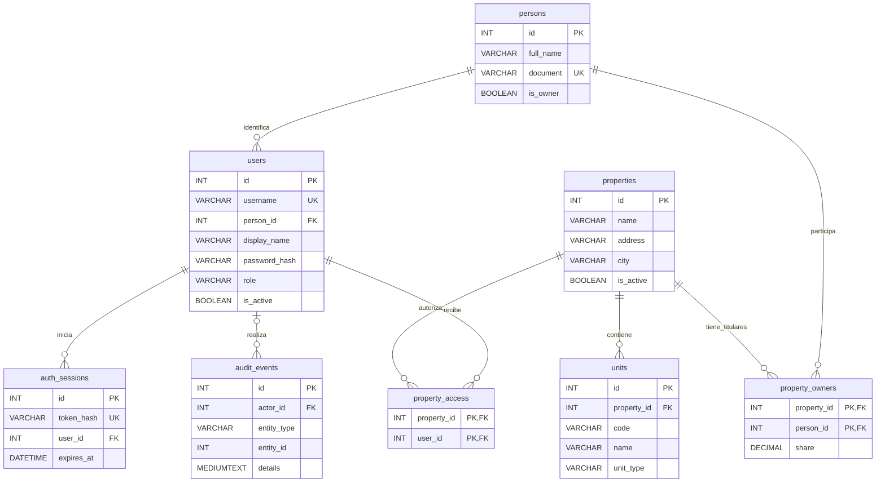

# Fase 1.1: análisis formal de normalización

Este documento analiza las ocho tablas de fase 1 y justifica el cambio mínimo de identidad de fase 1.1. No es un informe de ejecución de pruebas: los resultados de migraciones y regresión se documentan por separado.

## Alcance y criterio de demostración

La evaluación utiliza las dependencias funcionales (DF) que representan las reglas del dominio, las claves y las restricciones del esquema. No se deducen DF a partir de coincidencias accidentales en unos pocos registros. Una tabla no incumple 3FN por contener muchas columnas, ser una tabla puente o repetir un valor de catálogo como `role`.

Para una relación `R`, `X → Y` significa que dos filas con el mismo valor definido de `X` deben tener el mismo valor de `Y`. `R − K` representa los atributos de `R` que no pertenecen a la clave `K`.

- **1FN:** una fila tiene un valor del dominio definido en cada atributo; no hay columnas repetidas como `owner_1`, `owner_2` ni listas de propietarios dentro de la fila de una propiedad.
- **2FN:** ningún atributo no primo depende de una parte propia de alguna clave candidata. Un atributo primo participa en al menos una clave candidata, no solamente en la PK elegida.
- **3FN:** para toda DF no trivial `X → A`, `X` debe ser superclave o `A` debe ser primo. No se aplica el criterio simplificado de «tiene un id, por tanto está normalizada».

Las columnas opcionales de SQL pueden contener `NULL`. Un `UNIQUE` que admite varios `NULL` no se declara automáticamente clave candidata de toda la relación. Las DF condicionales se identifican expresamente y no se presentan como DF universales de una tabla SQL con datos desconocidos.

## Semántica de los atributos

Estas decisiones delimitan las DF usadas en la demostración:

1. `persons.full_name` es el nombre canónico de una persona, que puede cambiar con el tiempo.
2. En fase 1.1, cada cuenta referencia una persona mediante `users.person_id NOT NULL`. Una persona puede no tener cuentas o tener varias; `person_id` no es único en `users`.
3. `users.display_name`, si se especifica, es un alias independiente de esa cuenta. Dos cuentas de una misma persona pueden tener alias distintos. No se actualiza automáticamente cuando cambia el nombre de la persona. No existe la DF `person_id → display_name`.
4. El `full_name` devuelto por la API de usuarios se obtiene de `persons.full_name`; no es una columna almacenada en `users` después de la migración.
5. `persons.is_owner` significa «persona habilitada para ser seleccionada como propietaria». Puede ser verdadero antes de que se le registre una casa. No equivale al resultado de `EXISTS(property_owners)` y no se elimina como supuesto campo calculado.
6. `properties.address` y `persons.address` son textos de dirección tratados como un valor del dominio en el alcance actual. No se exige descomponer una dirección para analizar calles, números o coordenadas en esta fase.
7. No se presupone que `zone → city`, `address → city`, `email → person`, `phone → person` ni `full_name → person`. Las zonas, direcciones parciales y nombres pueden repetirse, y varias personas pueden compartir contacto.
8. `role` es una clasificación de cuenta global, sin nombre, descripción ni otros atributos del rol copiados en cada fila. Sus operaciones permitidas están definidas en el backend. Crear una tabla de roles no elimina ninguna DF transitiva almacenada actualmente.
9. `audit_events.details` es un documento histórico completo de un evento, tratado como un valor escalar opaco para este análisis relacional. No es la fuente editable de los atributos actuales de una persona, usuario o propiedad. **No se afirma que las listas o los objetos internos del JSON estén normalizados como relaciones independientes.** Si se necesitara consultarlos y modificarlos como entidades relacionales, sería otro requisito y exigiría otro diseño.

## Tablas originales y resultantes

Se mantienen las mismas ocho tablas; no se incorporan catálogos ni tablas puente adicionales sin una dependencia funcional que lo justifique.

| Tabla | Esquema de fase 1 | Esquema resultante y justificación |
| --- | --- | --- |
| `persons` | Identidad, contactos y categoría `is_owner` | Se conserva. Centraliza el nombre canónico y recibe personas creadas para cuentas que antes no tenían vínculo. |
| `properties` | Datos de cada inmueble | Se conserva. No hay DF no clave demostrada entre dirección, zona y ciudad. |
| `property_owners` | PK `(property_id, person_id)` y `share` | Se conserva. El porcentaje depende de la titularidad completa. |
| `units` | PK `id`, clave alternativa `(property_id, code)` | Se conserva. Sus atributos describen la unidad completa. |
| `users` | `full_name` almacenado y `person_id` opcional | Se elimina el nombre canónico duplicado; `person_id` pasa a obligatorio y `display_name` conserva un alias de cuenta independiente cuando corresponde. `full_name` es una proyección de la API. |
| `property_access` | PK `(property_id, user_id)` | Se conserva. Asigna alcance; no duplica el rol global del usuario. |
| `auth_sessions` | Sesión por usuario y hash único | Se conserva. Ni el vencimiento ni la creación dependen únicamente del usuario. |
| `audit_events` | Documento del evento en `TEXT` | Se conserva su significado histórico. La ampliación a `MEDIUMTEXT` en MySQL corrige capacidad; no se presenta como una corrección de 3FN. |

## Análisis individual

### 1. `persons`

**Atributos:** `R = {id, full_name, document, phone, whatsapp, email, address, notes, is_owner, created_at, updated_at}`.

**Clave candidata global:** `{id}`.

**DF global de identificación:** `id → R − {id}`.

`document` es opcional y único cuando está presente. En la subrelación `document IS NOT NULL`, y bajo la política actual de identificación inequívoca, `document` puede identificar la fila. No es clave candidata global porque varias filas admiten `NULL`. No se consideran claves `full_name`, `email`, `phone` ni `whatsapp`.

- **1FN:** cumple con los dominios definidos; los contactos ocupan atributos individuales y no una colección de contactos en una celda.
- **2FN:** cumple; la clave global es simple y no se identifica ninguna DF parcial a otra clave candidata.
- **3FN:** cumple bajo las DF declaradas. No hay otro atributo no clave que determine otro atributo no clave. La identificación alternativa condicional tampoco introduce un determinante no identificador dentro de su subrelación.
- **Anomalías:** conservar la identidad sin una cuenta o sin propiedades es una inserción válida, no una anomalía. La falta de tipo/país de documento limita el dominio de identificación y queda documentada; no es por sí misma una infracción de 3FN.
- **Antes y después:** misma estructura; se convierte en la única fuente del nombre personal para las cuentas.

### 2. `properties`

**Atributos:** `R = {id, name, address, zone, city, description, is_active, created_at, updated_at}`.

**Clave candidata:** `{id}`.

**DF:** `id → R − {id}`.

- **1FN:** cumple; los propietarios y las unidades se encuentran en relaciones separadas.
- **2FN:** cumple; no hay clave compuesta ni DF parcial demostrada.
- **3FN:** cumple; `zone` y `address` no determinan una ciudad de manera inequívoca en el dominio definido. No se introduce un catálogo geográfico por una DF supuesta.
- **Anomalías:** no se duplican aquí nombres de propietarios o datos de unidades, de modo que cambiar un contacto o un cuarto no obliga a modificar varias filas de propiedades. Que la API exija un dueño es una regla de integridad entre relaciones, no una DF interna.
- **Antes y después:** sin cambios por normalización.

### 3. `property_owners`

**Atributos:** `R = {property_id, person_id, share}`.

**Clave candidata:** `{property_id, person_id}`.

**DF:** `(property_id, person_id) → share`.

No existen las DF `property_id → share` ni `person_id → share`: una casa puede tener distintos copropietarios con porcentajes distintos y una persona puede tener diferentes porcentajes en distintas casas.

- **1FN:** cumple; una fila representa una titularidad, no una lista de dueños.
- **2FN:** cumple; `share` depende de toda la clave compuesta.
- **3FN:** cumple; no hay atributos no clave adicionales que produzcan una dependencia transitiva.
- **Anomalías:** la PK impide repetir la misma titularidad actual. Quitar una asociación no elimina a la persona ni a la propiedad. Cambiar una titularidad sustituye la asociación actual y deja el evento en auditoría, pero no crea periodos de vigencia estructurados.
- **Antes y después:** sin cambios. La falta de vigencias es una limitación funcional histórica, no un incumplimiento de 3FN.

### 4. `units`

**Atributos:** `R = {id, property_id, code, name, unit_type, description, maintenance, is_enabled, notes, created_at, updated_at}`.

**Claves candidatas:** `{id}` y `{property_id, code}`. Ambas tienen restricción de identificación; los dos componentes de la segunda son obligatorios.

**DF:**

- `id → R − {id}`.
- `(property_id, code) → R − {property_id, code}`.

`property_id` solo no identifica un cuarto y `code` solo puede repetirse en otra propiedad. No se ha definido que `unit_type` determine la descripción, el nombre o el estado de una unidad.

- **1FN:** cumple; cada fila representa una unidad y cada estado ocupa un atributo individual.
- **2FN:** cumple para **ambas** claves candidatas; ninguna parte de `(property_id, code)` determina los atributos no primos de la unidad.
- **3FN:** cumple; las DF no triviales declaradas tienen como determinante una clave candidata. Los datos de la casa no se repiten en las unidades.
- **Anomalías:** el mismo código puede usarse en casas diferentes sin duplicar la identidad de la unidad. La ausencia de un catálogo cerrado de tipos es una decisión de validación, no una DF transitiva almacenada.
- **Antes y después:** sin cambios por normalización.

### 5. `users`

**Atributos originales:** `R0 = {id, username, full_name, password_hash, role, person_id, is_active, created_at, updated_at}`.

**Atributos resultantes:** `R1 = {id, username, display_name, password_hash, role, person_id, is_active, created_at, updated_at}`.

**Claves candidatas, antes y después:** `{id}` y `{username}`. `person_id` no es candidato: varias cuentas pueden corresponder a la misma persona.

**DF de cuentas:**

- `id → R − {id}`.
- `username → R − {username}`.

**Problema semántico original:** si `users.full_name` significaba solamente una etiqueta independiente de cuenta, no estaba demostrada la DF `person_id → full_name` y no era correcto declarar una violación de 3FN únicamente porque existiera `persons.full_name`. Sin embargo, si ambas columnas pretendían guardar el mismo nombre personal, las cuentas vinculadas introducían la dependencia `person_id → full_name`, aunque `person_id` no fuera clave. En esa subrelación se obtenía `id → person_id → full_name`, con un atributo final no primo. La columna nullable de fase 1 obliga a expresar esta dependencia como semántica/condicional; no se la presenta falsamente como una DF universal ya impuesta por SQL.

La fase 1.1 resuelve la ambigüedad: toda cuenta representa a una persona; su nombre canónico solo se almacena en `persons`. `display_name` es un alias de cuenta, expresamente independiente y no sincronizado. La igualdad ocasional entre un alias y un nombre personal no crea una DF.

- **1FN original:** cumple para los atributos escalares de cuenta.
- **2FN original:** cumple bajo las claves `{id}` y `{username}`; son simples. El problema del nombre personal no es una dependencia parcial.
- **3FN original:** depende del significado de `full_name`: válida como etiqueta independiente; inconsistente con la regla de nombre personal canónico si se pretende duplicar ese dato.
- **1FN resultante:** cumple; identidad, alias, credenciales y rol tienen dominios individuales.
- **2FN resultante:** cumple; no hay dependencias parciales a sus claves simples.
- **3FN resultante:** cumple bajo las DF declaradas. El nombre personal no pertenece a `R1`; los restantes atributos dependen de la cuenta. `person_id` no determina alias, rol, contraseña o estado, porque una persona puede tener varias cuentas distintas.
- **Anomalía de actualización corregida:** renombrar una persona ya no exige sincronizar copias del nombre personal en todas sus cuentas.
- **Inserción:** crear una cuenta sin una persona previamente registrada crea ahora la identidad de forma explícita y atómica. Es un refuerzo de la nueva semántica; permitir antes cuentas no vinculadas no demostraba por sí solo una anomalía de 3FN.
- **Eliminación:** se conserva la conducta ya correcta de fase 1: deshabilitar una cuenta no elimina personas ni titularidades. No se atribuye esta protección existente a la nueva descomposición.

El paso a `person_id NOT NULL` es un refuerzo de integridad coherente con la nueva semántica. No se afirma que todas las relaciones opcionales violen 3FN.

### 6. `property_access`

**Atributos:** `R = {property_id, user_id}`.

**Clave candidata:** `{property_id, user_id}`.

No existen atributos no primos ni DF no triviales hacia atributos externos a esa clave. `property_id` no determina `user_id` y `user_id` no determina `property_id`: la relación es muchos a muchos.

- **1FN:** cumple; cada fila representa una asignación.
- **2FN:** cumple; no hay atributos no primos dependientes de una parte de la clave.
- **3FN:** cumple por el mismo motivo, sin una dependencia transitiva no clave.
- **Anomalías:** la PK evita asignaciones repetidas. Conceder o quitar una asignación no exige copiar ni borrar los datos de la cuenta o de la propiedad.
- **Antes y después:** sin cambios. Copiar aquí el rol global de `users` introduciría `user_id → role`, una dependencia parcial respecto de la clave compuesta; por eso no se añade esa redundancia como supuesta mejora de normalización.

Permitir distintos roles en distintas casas sería otra regla funcional, con otro conjunto de DF. No se implementa anticipadamente.

### 7. `auth_sessions`

**Atributos:** `R = {id, token_hash, user_id, expires_at, created_at}`.

**Claves candidatas:** `{id}` y `{token_hash}`; ambas son obligatorias y únicas.

**DF:** `id → R − {id}` y `token_hash → R − {token_hash}`.

No existe `user_id → expires_at` ni `user_id → created_at`: un usuario puede tener varias sesiones iniciadas en momentos distintos. El backend fija un vencimiento de ocho horas al iniciar la sesión, pero calcula ese plazo con una lectura del reloj distinta de la usada por el valor predeterminado `created_at` al insertar. No existe una igualdad SQL ni una DF declarada `created_at → expires_at`; el instante almacenado de creación no determina exactamente el plazo observado. El vencimiento es un dato de la sesión, no una copia del estado del usuario. Una misma fecha de creación tampoco identifica una sesión.

- **1FN:** cumple.
- **2FN:** cumple; las claves son simples y no hay DF parcial.
- **3FN:** cumple bajo las DF declaradas; no se copian nombres, contraseñas o permisos dentro de cada sesión.
- **Anomalías:** deshabilitar una cuenta no requiere modificar una copia de su estado en cada sesión; el backend consulta el usuario real. La conservación del hash y no del token original es una decisión de seguridad, no una descomposición de 3FN.
- **Antes y después:** sin cambios por normalización.

### 8. `audit_events`

**Atributos:** `R = {id, actor_id, action, entity_type, entity_id, details, created_at}`.

**Clave candidata:** `{id}`. Ni `(entity_type, entity_id)` ni `(actor_id, created_at)` son únicas: un recurso puede cambiar muchas veces y varios eventos pueden compartir instante y actor.

**DF:** `id → R − {id}`.

No existe `(entity_type, entity_id) → details`: cada modificación tiene su documento histórico distinto. Un nombre personal guardado como valor anterior de un evento depende de ese evento, no del nombre actual de la persona. Retocar todos los eventos al cambiar una persona destruiría la fidelidad del historial.

- **1FN:** cumple en el nivel relacional declarado, que trata `details` como un documento completo y opaco de un evento. Esta afirmación **no** normaliza ni certifica el esquema interno de su JSON. Si se define el dominio como una colección de cambios relacionales editables, no podría reclamarse esta misma demostración sin descomponerlo.
- **2FN:** cumple para la clave simple `{id}`.
- **3FN:** cumple en ese nivel: las DF no triviales declaradas tienen como determinante el evento. No se guardan columnas de nombre/rol actuales del actor que dependan de `actor_id`.
- **Anomalías:** preservar un valor antiguo no es la anomalía de actualización de una copia de dato vivo; es el propósito del registro histórico. `entity_id` sin FK polimórfica y la falta de inmutabilidad SQL son limitaciones de integridad/auditoría separadas, no evidencia de una DF transitiva.
- **Antes y después:** mismo significado y claves. Ampliar `TEXT` a `MEDIUMTEXT` evita que los documentos antes/después excedan la capacidad de MySQL; no prueba ni cambia una forma normal.

## Preservación de datos y descomposición de identidad

La migración incremental no cambia las revisiones anteriores ni los identificadores de usuarios, personas existentes, propiedades, unidades, sesiones o eventos.

- Para un usuario con `person_id` válido, se conserva la persona existente como identidad canónica.
- Si el nombre previo de esa cuenta discrepa del nombre de la persona, se conserva como alias `display_name`; no se sobreescribe ninguno de los dos nombres ni se elige arbitrariamente uno para todas las cuentas.
- Para cada usuario sin `person_id`, se crea una persona usando su nombre previo y se vincula la cuenta. Dos cuentas con el mismo texto de nombre no se fusionan: la igualdad de nombres no demuestra identidad.
- Los propietarios sin cuenta siguen siendo registros válidos de `persons`. Tener una persona no implica crear un usuario.
- Los documentos de auditoría anteriores permanecen como historia de la versión anterior. No se reescriben para que parezcan haber sido generados por el esquema nuevo.

Con la FK obligatoria, la unión `users JOIN persons ON users.person_id = persons.id` devuelve exactamente una identidad por cuenta; no pierde cuentas ni genera múltiples copias de una misma cuenta. Que varias cuentas compartan persona es permitido y no multiplica cada fila individual al unir con la PK de `persons`.

## Qué permanece en SQL y qué depende del backend

| Regla | Garantía SQL | Garantía del backend |
| --- | --- | --- |
| Cada cuenta referencia una persona existente | FK y `NOT NULL` en fase 1.1 | Selección de persona o alta atómica de identidad |
| No duplicar documentos definidos, usuarios, sesiones ni números de cuarto por casa | Restricciones `UNIQUE` y PK | Normalización de texto y errores comprensibles |
| Cada participación individual cumple `0 < share <= 100` o es desconocida | `CHECK ck_owner_share` | Validación de entrada equivalente |
| Existe al menos un propietario y la suma indicada no supera 100% | No es una DF ni una restricción SQL entre filas actualmente | Validación de propietarios y participaciones |
| Solo una cuenta autorizada consulta/modifica cada casa | Las FK mantienen las referencias, no autorizan peticiones | Sesión, rol y alcance por propiedad en cada solicitud |

Estos límites no deben confundirse con formas normales. Tampoco un esquema en 3FN garantiza por sí solo que una aplicación autorice bien, conserve historia legal o ejecute una operación económica una sola vez.

## Diagrama resultante

Las líneas indican las relaciones y cardinalidades. El `UK` nullable de `persons.document` expresa la restricción SQL de unicidad condicional; no lo convierte en clave candidata global. La unicidad compuesta `(property_id, code)` de `units` se mantiene aunque el diagrama resumido no la represente como un campo único. `audit_events.entity_id` sigue siendo una referencia lógica y no una FK a todas las tablas posibles.

## Mejoras funcionales que no se incorporan por normalización

- **Titularidades con vigencia:** `property_owners` mantiene dueños actuales. La auditoría conserva cambios, pero no hay `valid_from`/`valid_to` legales. Consultar ingresos históricos usando solo dueños actuales sería insuficiente; definir esa regla corresponde al diseño contractual/financiero posterior.
- **Permisos por periodo y varios roles simultáneos:** la cuenta conserva un rol global y las asignaciones actuales. Cambiar eso amplía las reglas autorizadas de fase 1 y no es necesario para 3FN con las DF actuales.
- **Capital, contratos, servicios y pagos:** faltan deliberadamente las relaciones de esas fases. No se crean tablas financieras para demostrar una forma normal del catálogo actual.
- **Inmutabilidad y referencias de auditoría:** el documento no sustituye un libro financiero, y un usuario con acceso SQL suficiente puede modificarlo. Requiere decisiones de permisos de base y registro económico posteriores.
- **Identificación por emisor/tipo:** el texto único de documento tiene un alcance limitado. No se añade un catálogo de documentos sin requisitos de identificación confirmados.

## Conclusión del análisis

Para el esquema resultante y los dominios/DF expresamente definidos, cada DF no trivial identificada tiene como determinante una clave candidata o una superclave; las tablas puente no presentan dependencias parciales, y la identidad personal deja de almacenarse como copia dentro de cuentas. Esto demuestra 3FN **respecto de esas dependencias**, no respecto de reglas futuras todavía no definidas ni respecto de la estructura interna del documento JSON de auditoría.

La demostración de formas normales es un razonamiento sobre el esquema y el dominio. Las pruebas de migración, restricciones, autenticación, permisos y regresión aportan evidencia de implementación, pero no sustituyen ese razonamiento ni permiten afirmar propiedades que no se han especificado.
