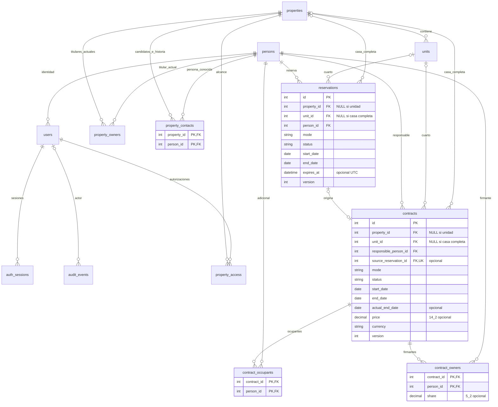

# Entrega de fase 2: contratos, reservas y ocupación

Fecha de verificación: 6 de noviembre de 2026. Rama de trabajo: `phase-2-contracts-occupancy`, creada desde el main integrado `437b30d030280eabfe8beb45e482dfe9a82ecd5c`. Los cambios se entregan en un commit local, sin publicación ni merge. No se modifican las revisiones 0001–0003 ni otros proyectos.

Dependencias y criterios previos: [phase-2-plan.md](phase-2-plan.md). API, reglas de fechas, permisos y ejemplos: [phase-2-api.md](phase-2-api.md).

## Funcionalidades implementadas

- Contratos diarios inclusivos por defecto y alternativos por noches; la ocupación siempre incluye entrada y salida. Todos los servicios están incluidos, incluso en estancias mayores de 15 días.
- Contratos semanales con semanas calculadas desde las fechas y autorización explícita para periodos parciales. El asistente también permite introducir semanas para calcular la salida.
- Contratos mensuales por aniversario o calendario, primer periodo completo/proporcional, día de vencimiento y modalidad de cobro. Periodos informativos con meses reales y sin arrastre del aniversario del día 31.
- Borradores, vigentes, finalizados y cancelados; modificación, activación, cancelación previa a entrada, finalización anticipada y prórroga. Versiones para detectar formularios desactualizados e historial anterior/posterior con actor.
- Responsable, varios ocupantes adicionales y propietarios firmantes vinculados a `persons`, sin cuentas obligatorias ni nombres copiados. Firmantes independientes de la titularidad actual; las altas históricas vigentes exigen selección expresa.
- Alquiler de casa completa o cuarto; bloqueo mutuo, límites inclusivos y comprobaciones transaccionales reales en MySQL.
- Reservas pendientes y confirmadas, edición, confirmación, cancelación, vencimiento efectivo inmediato y conversión atómica en contrato, sin duplicarlo al repetir la solicitud.
- Disponibilidad actual y futura por casa y cuarto, motivos de ocupación/reserva/mantenimiento/deshabilitación y resumen de hoy en el detalle de la propiedad.
- Ocupantes actuales e historial de estancias finalizadas y de cambios de personas. Registro de inquilinos desde los formularios sin crear cuentas ni revelar personas ajenas.
- Pantallas React en español, registro guiado de ocho pasos, confirmaciones, botones grandes y texto de 16–18 px. Navegación móvil en dos columnas para mantener accesibles las nuevas secciones.

Anticrético permite registrar únicamente inmueble, fechas, personas y condiciones, sin capital ni devolución. Mixto permite solo un borrador con condiciones escritas, sin activación ni cálculo ambiguo. Se almacena el precio pactado de alquiler; **no se crean facturas, cargos, deudas, pagos, movimientos financieros ni recordatorios**. La regla de servicios de 15 días queda para fase 3.

## Tablas y relaciones resultantes

Se conservan las ocho tablas de fase 1.1: `persons`, `properties`, `property_owners`, `units`, `users`, `property_access`, `auth_sessions`, `audit_events`. La migración agrega cinco: **trece tablas de aplicación**, además de `alembic_version`.

| Tabla nueva | Finalidad | Clave primaria | Relaciones |
| --- | --- | --- | --- |
| `contracts` | Acuerdo, términos, responsable, fechas y estado | `id` | Casa completa **o** unidad; persona responsable; reserva de origen opcional y única. |
| `contract_occupants` | Ocupantes adicionales distintos del responsable | `(contract_id, person_id)` | N:M entre contratos y personas. |
| `contract_owners` | Propietarios firmantes de un acuerdo | `(contract_id, person_id)` | N:M entre contratos y personas, conservada al activar. |
| `reservations` | Estancia prevista y bloqueo temporal | `id` | Casa completa **o** unidad; persona que reserva. |
| `property_contacts` | Personas conocidas/autorizadas para una casa e identidades históricas | `(property_id, person_id)` | N:M entre propiedades y personas; no concede acceso a cuentas. |

Una persona puede ser responsable de muchos contratos y reservar muchas estancias; puede ser ocupante/firmante en muchos contratos. Una casa/unidad admite muchos contratos y reservas en periodos compatibles. Una reserva puede originar **cero o un contrato**, y un contrato tiene **cero o una reserva de origen**. Responsable y firmantes son relaciones diferentes, aunque una misma persona pueda cumplir ambos papeles en un acuerdo válido.

El responsable se guarda una sola vez en `contracts.responsible_person_id`; los adicionales se guardan como filas individuales. El backend rechaza repetir al responsable entre ellos. No se crea una tabla de ocupaciones duplicada: el intervalo ocupado deriva del contrato y de su finalización real. Los cambios relevantes son eventos de `audit_events` y no sustituyen la relación operacional vigente.

### Campos nuevos

Tipos MySQL. `NULL` indica campo opcional. Los booleanos de SQLAlchemy se representan mediante `TINYINT(1)` en MySQL.

| `contracts` | Tipo | Significado |
| --- | --- | --- |
| `id` | INT, PK autoincremental | Identificador del contrato. |
| `property_id` | INT NULL, FK `properties.id` | Casa completa. |
| `unit_id` | INT NULL, FK `units.id` | Unidad; su propiedad se obtiene de `units`. |
| `responsible_person_id` | INT, FK `persons.id` | Responsable contractual. |
| `source_reservation_id` | INT NULL, FK `reservations.id`, UNIQUE | Reserva convertida, si existe. |
| `mode` | VARCHAR(20) | daily/weekly/monthly/anticretico/mixed. |
| `status` | VARCHAR(20) | draft/active/finished/cancelled. |
| `start_date` | DATE | Entrada pactada e inclusiva. |
| `end_date` | DATE | Salida pactada e inclusiva, incluyendo prórrogas. |
| `actual_end_date` | DATE NULL | Salida real al finalizar, sin perder la pactada. |
| `price` | DECIMAL(14,2) NULL | Precio de alquiler; nulo para anticrético/mixto en esta fase. |
| `currency` | VARCHAR(3) | Moneda explícita. |
| `daily_count` | VARCHAR(20) NULL | inclusive/nights, solo diario. |
| `weekly_partial_allowed` | TINYINT(1) NULL | Permiso de semanas parciales, solo semanal. |
| `monthly_period` | VARCHAR(20) NULL | anniversary/calendar, solo mensual. |
| `first_period` | VARCHAR(20) NULL | full/prorated, solo mensual. |
| `due_day` | INT NULL | Día mensual pactado 1–31. |
| `payment_timing` | VARCHAR(20) | advance/arrears/custom. |
| `due_terms` | TEXT NULL | Acuerdo escrito de vencimientos. |
| `services_included` | TINYINT(1), predeterminado 0 | Inclusión pactada; siempre verdadero para diario. |
| `service_terms` | TEXT NULL | Condiciones escritas, sin cálculo de servicios. |
| `conditions` | TEXT NULL | Condiciones adicionales. |
| `notes` | TEXT NULL | Observaciones. |
| `version` | INT, predeterminado 1 | Control de ediciones concurrentes. |
| `created_at`, `updated_at` | DATETIME | Instantes UTC de registro/modificación. |

| `reservations` | Tipo | Significado |
| --- | --- | --- |
| `id` | INT, PK autoincremental | Identificador. |
| `property_id` | INT NULL, FK `properties.id` | Casa completa. |
| `unit_id` | INT NULL, FK `units.id` | Unidad, alternativamente. |
| `person_id` | INT, FK `persons.id` | Persona que reserva. |
| `mode` | VARCHAR(20) | daily/weekly/monthly/anticretico. |
| `start_date`, `end_date` | DATE | Fechas inclusivas de la estancia. |
| `status` | VARCHAR(20) | pending/confirmed/cancelled/expired/converted. |
| `expires_at` | DATETIME NULL | Vencimiento UTC de la reserva. |
| `notes` | TEXT NULL | Observaciones. |
| `version` | INT, predeterminado 1 | Control de edición. |
| `created_at`, `updated_at` | DATETIME | Instantes UTC. |

| Tabla | Campos y tipos |
| --- | --- |
| `contract_occupants` | `contract_id INT` PK/FK `contracts.id`; `person_id INT` PK/FK `persons.id`. |
| `contract_owners` | `contract_id INT` PK/FK `contracts.id`; `person_id INT` PK/FK `persons.id`; `share DECIMAL(5,2) NULL`. |
| `property_contacts` | `property_id INT` PK/FK `properties.id`; `person_id INT` PK/FK `persons.id`. |

`contract_owners.share` es la participación pactada de esos firmantes, opcional; no es una copia que deba actualizarse con `property_owners.share`. El formulario conserva la participación propuesta y permite cambiar firmantes en borrador. La API valida duplicados y suma no superior al 100%. No se usa para repartir servicios ni ingresos.

### Integridad, índices y límites de aplicación

- Todas las FK nuevas tienen `ON DELETE RESTRICT`. Las PK compuestas impiden repetir personas dentro de cada relación. `source_reservation_id` es único para los valores no nulos.
- `ck_contract_target` y `ck_reservation_target` exigen exactamente una casa completa o una unidad; no ambas ni ninguna.
- Fechas ordenadas, modos y estados válidos tienen CHECK. Precio positivo y no nulo en alquileres; nulo para anticrético/mixto. Diario incluye servicios obligatoriamente. Mixto solo borrador/cancelado. `actual_end_date` obligatorio y dentro del intervalo únicamente al finalizar. Día de vencimiento 1–31 y participación válida tienen CHECK.
- Índices `ix_contract_property_dates`, `ix_contract_unit_dates`, `ix_reservation_property_dates`, `ix_reservation_unit_dates` apoyan las búsquedas de intervalos; `ix_reservation_expiry` apoya el vencimiento. Las FK disponen de los índices que exige InnoDB. Se conservan los anteriores.
- Pydantic y servicios validan campos por modalidad, roles, personas candidatas, suma de participaciones, transiciones y superposición. Estas reglas que relacionan múltiples filas no se presentan como si todas fueran CHECK SQL. La superposición se impide mediante el bloqueo de propiedad y lecturas actuales descritos en la API; también se probaron operaciones simultáneas.
- `resolved_property_id`, `target_label`, `periods`, `effective_status`, `allows_service_charges` y `current` son proyecciones calculadas, no columnas redundantes. No se guarda cantidad de semanas/días cuando ya deriva de las fechas y su regla.

## Diagrama entidad-relación

Las dos flechas de destino de contratos/reservas son alternativas: se cumple el XOR de casa completa o unidad. El diagrama muestra el esquema operacional; el contenido histórico de auditoría no tiene FK polimórfica a cada tipo de recurso.



## Demostración de normalización

Se aplica la misma semántica de identidad y documento de auditoría ya demostrada en [fase 1.1](phase-1.1-normalization.md). Las ocho relaciones anteriores mantienen sus atributos, claves y dependencias funcionales (DF). A continuación se analizan las cinco nuevas; no se deduce 3FN por contar tablas ni por usar un ORM.

### Dominios y dependencias consideradas

Nombres, direcciones, nombres de cuartos y datos de cuentas pertenecen a sus entidades existentes. Precio, moneda y fechas son acuerdos particulares: ni una modalidad ni una unidad determinan un precio o una moneda universal. Una persona puede asumir papeles distintos en diferentes contratos y no determina sus fechas, estado o condiciones. Una unidad puede tener muchos contratos sucesivos y borradores simultáneos: `(unit_id, start_date)` no se declara clave candidata sin una unicidad real.

1. **`contracts`**. `R` es exactamente el conjunto de columnas de la tabla enumeradas arriba. Clave candidata total: `{id}`. DF: `id → R−{id}`. En la subrelación de contratos procedentes de reserva, donde `source_reservation_id IS NOT NULL`, la unicidad impuesta establece además `source_reservation_id → id → R`. Se trata de una clave alternativa **condicional**, no una clave candidata universal, porque los contratos directos admiten nulo. Los términos del contrato pueden modificarse con historial después de convertir; la reserva conserva su propuesta original. Por tanto las fechas/persona/precio del contrato no son copias sincronizadas de los de la reserva.
2. **`reservations`**. `R={id,property_id,unit_id,person_id,mode,start_date,end_date,status,expires_at,notes,version,created_at,updated_at}`. Clave candidata `{id}` y DF `id → R−{id}`. No existe unicidad natural de persona/fechas/espacio: se conservan cancelaciones y pueden volver a reservarse las mismas fechas. El estado efectivo vencido se calcula; no es otra columna que deba sincronizarse con el plazo.
3. **`contract_occupants`**. `R={contract_id,person_id}`. Única clave candidata declarada: todo `R`. No hay atributos no clave ni DF no triviales hacia atributos ajenos a la clave. Ninguno de los dos identificadores por separado es único.
4. **`contract_owners`**. `R={contract_id,person_id,share}`. Clave candidata `{contract_id,person_id}`. DF `(contract_id,person_id) → share`. Un firmante puede tener participaciones distintas en contratos distintos y un contrato puede tener varios firmantes con participaciones distintas; no existen `person_id → share` ni `contract_id → share`. La participación actual de un inmueble y la contractual histórica son hechos diferentes, no datos que deban permanecer iguales.
5. **`property_contacts`**. `R={property_id,person_id}`. Única clave candidata declarada: todo `R`. No hay atributos no clave ni DF no triviales hacia otros atributos. Una persona puede estar vinculada a varias casas y una casa a muchas personas.

### 1FN, 2FN y 3FN por relación

| Relación | 1FN | 2FN | 3FN según las DF anteriores |
| --- | --- | --- | --- |
| `contracts` | Fechas, importes, flags y condiciones textuales son valores individuales; adicionales y firmantes son filas separadas. | La clave candidata total es simple; no hay dependencia de una parte propia de ella. | El único determinante total no trivial identificado es `id`, una clave. La clave alternativa de reserva también es superclave en su subrelación. No se guardan atributos personales ni de propiedad dependientes de otra FK. |
| `reservations` | Un destino, una persona y un valor por columna; sin listas de personas ni espacios repetidos. | Clave simple. | El determinante no trivial identificado es `id`; nombres/direcciones y estado efectivo no se duplican. |
| `contract_occupants` | Una persona por fila. | Sin atributos no clave que dependan de una parte de la clave. | No hay DF no trivial con determinante no superclave. |
| `contract_owners` | Un firmante y una participación por fila. | `share` depende del par completo y no de uno de sus componentes. | No existe atributo no clave intermedio que determine `share`; el determinante es la clave compuesta. |
| `property_contacts` | Una asociación por fila. | Sin atributos no clave. | No hay DF no trivial con determinante no superclave. |

**Decisión relevante:** no se guarda a la vez `unit_id` y la casa de esa unidad. Eso introduciría la DF semántica `unit_id → property_id` dentro de contratos y reservas, siendo `unit_id` no clave y `property_id` no primo. El XOR separa las subrelaciones de casa completa y de unidad sin ese dato repetido; el backend deriva la propiedad para permisos y pantalla.

Para cada DF no trivial identificada, el determinante es una superclave de su relación/subrelación. Esto demuestra al menos 3FN bajo los dominios y DF documentados. No demuestra reglas futuras todavía no definidas ni que un sistema normalizado garantice por sí mismo concurrencia, autorización o historia legal.

Los nulos expresan alternativas de destino y condiciones no aplicables; no se presentan como claves universales. Un `mode` concreto puede imponer una condición constante en su subrelación —por ejemplo, diario incluye servicios— sin que exista una DF global `mode → services_included`: otras modalidades permiten ambas opciones. No se inventa una tabla de modalidades solo para separar una validación de dominio.

La auditoría mantiene un **documento inmutable del evento**, no una segunda fuente de datos actuales. Su análisis formal al nivel de documento atómico está en fase 1.1; no se afirma que sus miembros JSON internos formen otra relación normalizada. Las listas de IDs del documento sirven para reconstruir el cambio histórico, no sustituyen las tablas puente. Las personas referenciadas siguen siendo consultables en el ámbito de la casa; no se elimina historia al cambiar los adicionales actuales.

Anomalías evitadas: renombrar una persona no exige editar sus contratos; cambiar el dueño actual no reescribe firmantes antiguos; cambiar una dirección no exige editar reservas; añadir un ocupante no introduce columnas repetidas; quitarlo de un acuerdo no borra los eventos anteriores. `end_date` pactada y `actual_end_date` real no son datos redundantes: pueden diferir legítimamente al finalizar anticipadamente.

## Migración y recuperación

Revisión nueva: [`0004_tenancy`](../backend/migrations/versions/0004_tenancy.py), con `down_revision = "0003_identity"`. Crea únicamente las cinco tablas, sus FK, CHECK, PK, unicidad e índices. No altera ni copia datos de las ocho anteriores. Los modelos nuevos se registran en `migrations/env.py`; `alembic check` comprueba su concordancia.

Desde `backend`, con `DATABASE_URL` configurada para la base del proyecto:

```bash
../.venv/bin/alembic current
../.venv/bin/alembic upgrade head
../.venv/bin/alembic check
```

Antes de migrar una base que deba conservarse: detener escritores, verificar respaldo y restauración en una copia, comprobar que está en 0003 y ensayar ahí 0004. Estas instrucciones no autorizan ni ejecutaron cambios sobre datos reales.

MySQL hace commits implícitos de DDL. Si una aplicación falla a mitad, conservar el error y revisar versión/objetos creados; no asumir rollback completo ni usar `alembic stamp` para ocultar un esquema parcial. La recuperación preferida es restaurar el respaldo verificado en una base aislada, comprobar 0003 y volver a aplicar la migración corregida. Reintentar sin revisar puede encontrar tablas ya creadas.

En una **base descartable o restauración aprobada**, `alembic downgrade 0003_identity` elimina las cinco tablas de fase 2 y conserva las ocho anteriores. Eso **pierde los contratos/reservas nuevos**: no es una opción inocua si contienen datos que deban conservarse. Respaldarlos antes o restaurar una copia completa. La reversión deja que `DROP TABLE` retire los índices junto con sus FK; MySQL impedía retirarlos por separado mientras sostenían esas FK. La prueba sube/baja/sube y compara todos los registros anteriores.

## Pruebas y regresión

Resultados definitivos y comandos: [phase-2-tests.md](phase-2-tests.md). Backend: **141 pruebas aprobadas**; React: **21 aprobadas**; navegador: **22 aprobadas** en escritorio y móvil. Cero fallidas y cero omitidas. Migraciones y build correctos. Se utiliza Python 3.12, Node 24, MySQL 8.4 y Chromium, con dos bases nuevas descartables y datos ficticios. No se alteraron bases reales.

Las fases 0/1/1.1 mantienen sus comprobaciones de conexión, identidad única en personas, propietarios con varias casas, cuartos, roles, sesiones, autenticación y auditoría. Los tests de migración 1.1 siguen ensayando su revisión específica y restauran `head` al terminar. La prueba de integración reconoce el nuevo head 0004. CI queda configurado para las tres variables de bases de prueba, sin afirmar que se haya ejecutado en GitHub.

Antes del commit se revisaron archivos nuevos/modificados y los valores privados temporales usados por las pruebas: sin coincidencias de credenciales reales ni archivos `.env` para versionar. `.env.example` y los ejemplos públicos de CI se conservan como configuración de desarrollo, sin secretos. Las revisiones 0001–0003 permanecen idénticas al main de partida. La rama `main` no recibió cambios.

## Archivos principales

- `backend/app/models/tenancy.py`: cinco modelos nuevos; `schemas/tenancy.py`: entradas estrictas, modalidades y acciones.
- `backend/app/services/tenancy.py`: disponibilidad, bloqueo, permisos, estados, conversión y auditoría; `services/periods.py`: conteos/periodos.
- `backend/app/api/tenancy.py` y `main.py`: rutas e integración. `api/registry.py` amplía la consulta autorizada de personas a relaciones contractuales.
- `backend/migrations/versions/0004_tenancy.py`, `migrations/env.py`: evolución incremental y registro de modelos.
- `backend/tests/test_tenancy.py`, `test_migration_2.py`: reglas, integridad, migraciones y concurrencia real. Adaptaciones mínimas de pruebas previas al nuevo head.
- `frontend/src/pages/Tenancy.tsx`: listas/detalle/acciones; `pages/tenancy/ContractWizard.tsx`, `ReservationForm.tsx`, `Screens.tsx`, `Shared.tsx`: componentes separados.
- `frontend/src/tenancy.ts`, `App.tsx`, `api.ts`, `styles.css`, `pages/Properties.tsx`, `People.tsx`: tipos, navegación, errores, disponibilidad y consultas de personas.
- `frontend/tests/Tenancy.test.tsx`, `frontend/e2e/tenancy.spec.ts`: pruebas React y recorridos completos.
- `.github/workflows/checks.yml`, README y documentos de fase 2: instrucciones y verificación reproducible. Sin dependencias nuevas de aplicación.

## Capturas

Todas utilizan personas/casas ficticias de pruebas. Escritorio 1440×1000 y móvil 390×844. Capturas completas, revisadas visualmente; la prueba de navegador también comprueba que no haya desbordamiento horizontal.

| Pantalla | Escritorio | Móvil |
| --- | --- | --- |
| Resumen del asistente | [Ver](screenshots/phase-2-escritorio-resumen.png) | [Ver](screenshots/phase-2-movil-resumen.png) |
| Detalle e historial de contrato | [Ver](screenshots/phase-2-escritorio-contrato.png) | [Ver](screenshots/phase-2-movil-contrato.png) |
| Disponibilidad de casa/cuarto | [Ver](screenshots/phase-2-escritorio-disponibilidad.png) | [Ver](screenshots/phase-2-movil-disponibilidad.png) |
| Reservas | [Ver](screenshots/phase-2-escritorio-reservas.png) | [Ver](screenshots/phase-2-movil-reservas.png) |
| Ocupantes históricos | [Ver](screenshots/phase-2-escritorio-historial.png) | [Ver](screenshots/phase-2-movil-historial.png) |

## Cómo probar desde el navegador

1. Sigue instalación, migraciones y arranque de [README](../README.md). Abre `http://localhost:5173` o el puerto 5173 del entorno. Inicia sesión con tu cuenta. Para un ensayo, usa una base propia de pruebas y crea su primer administrador; no hay contraseña predeterminada.
2. Registra una persona propietaria, una casa y al menos dos cuartos en Propiedades. Puedes usar varias casas de la misma persona, como antes.
3. En Contratos, pulsa “Registrar contrato”. Elige casa, cuarto A y Diario. Selecciona o registra una persona sin cuenta, añade ocupantes, revisa firmantes y fija del 1 al 3 de un mes futuro. Precio, moneda, servicios incluidos y estado Vigente; revisa el resumen y confirma. Debe mostrar tres días cobrables. Por noches serán dos, pero la salida continúa ocupada.
4. Intenta registrar la casa completa o el mismo cuarto en las mismas fechas: debe explicar el conflicto. El cuarto B seguirá disponible; otra estancia puede comenzar al día siguiente de la salida.
5. Consulta Disponibilidad para ese periodo. La casa completa y A aparecen ocupados, B disponible. El detalle de Propiedades muestra la situación de hoy; cambia las fechas en Disponibilidad para consultar el futuro.
6. Registra un semanal de siete días (entrada y salida incluidas). Para nueve días habilita semanas parciales. Para mensual elige calendario/aniversario, primer periodo y vencimiento; el detalle muestra los días reales sin crear cargos.
7. En Reservas, elige otras fechas, registra una persona, guarda Pendiente y confirma. “Convertir reserva … en contrato” abre los ocho pasos con los datos originales; completa precio/condiciones y confirma. La reserva debe quedar convertida y existir un solo contrato. En otra reserva prueba cancelar. Para vencimiento utiliza un plazo próximo y consulta después: libera las fechas sin envíos automáticos.
8. En un contrato vigente usa Modificar o Prorrogar y revisa Historial de cambios. Para una estancia que ya comenzó, Finalizar exige una fecha real entre entrada y hoy y un motivo; conserva la salida pactada. En Ocupantes e historial deben seguir sus personas. No se permite convertir una estancia real pasada en una cancelación que borre su ocupación.
9. Marca un cuarto en mantenimiento o deshabilitado; comprueba que no se active una nueva ocupación ahí ni de casa completa, y que otros cuartos habilitados puedan usarse. Es un estado actual, no un calendario de obras futuras.
10. Prueba cuentas de administrador de propiedad, operador y propietario en casas distintas. El operador prepara borradores/reservas, los administradores activan y el propietario consulta. El backend impide acceso cruzado aunque se cambien IDs.

## Problemas conocidos y funciones pendientes

- No quedan fallos conocidos en las comprobaciones ejecutadas. No se han hecho pruebas de carga ni revisión presencial con personas mayores; las listas aún no tienen paginación/búsqueda avanzada. Chromium de escritorio y móvil son los navegadores automatizados; no se declara certificación de otros navegadores o WCAG.
- Se conservan eventos con IDs y términos anteriores/posteriores. No se añade un historial jurídico de titularidades con vigencia, ni fechas efectivas individuales por cada cambio de ocupante. Los firmantes del contrato proporcionan una base histórica independiente del dueño actual; las fases financieras deberán referenciar el contrato y congelar sus propias asignaciones cuando se confirmen.
- Mantenimiento/deshabilitación son estados actuales. Las reservas vencen efectivamente al consultar/verificar disponibilidad; su cambio persistente de estado se registra manualmente. No hay planificador de tareas.
- El vencimiento mensual es informativo y los periodos parciales muestran días/condiciones. No se ha decidido un cálculo financiero para el último periodo incompleto ni para combinaciones mixtas; no se generan cobros ambiguos.
- Anticrético carece todavía de capital/devoluciones (fase 5); mixto queda en borrador. Servicios y regla de 15 días, pagos, WhatsApp, dashboard financiero y PDF permanecen en las fases autorizadas futuras.
- Persisten los límites de despliegue ya documentados: HTTPS/proxy y gestión operativa, límite de intentos en memoria por proceso y ausencia de recuperación de contraseña por canales externos. El esquema 3FN no equivale a una auditoría integral de seguridad.

Las siguientes fases quedan detenidas para revisión del usuario. No se publicó la rama ni se realizó merge.
