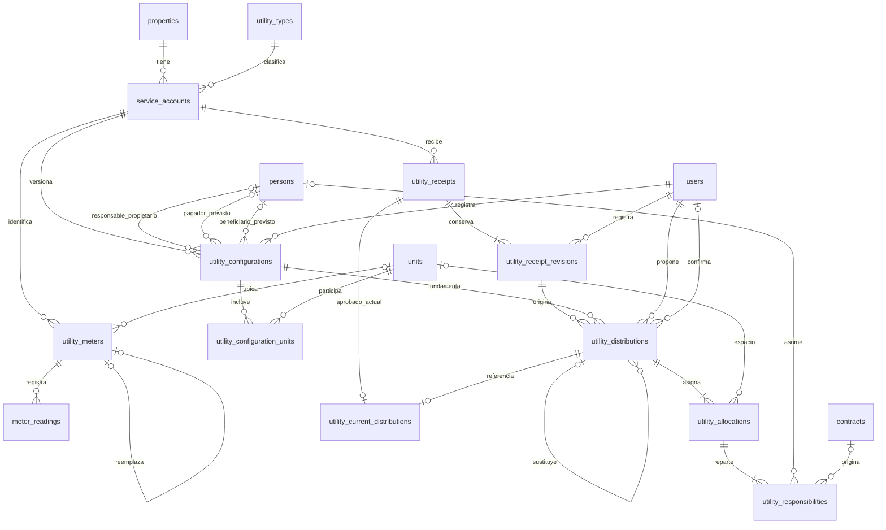

# Fase 3 — Servicios básicos, recibos y distribución de gastos

Entrega local del 7 de noviembre de 2026. Rama `phase-3-utilities-billing`, creada desde `origin/main` en `d0334b8`, con las fases 0, 1, 1.1 y 2 integradas. El commit de esta entrega se comunica al finalizar; este documento forma parte del propio commit. No se publica la rama ni se integra a `main`.

## Funcionalidades implementadas

- Catálogo configurable, inicialmente Electricidad, Agua, Internet, Gas, Recolección de basura y Otros servicios. Activación/desactivación sin eliminación de historia.
- Suministros por casa, individuales o compartidos, con proveedor, número externo, cuartos participantes o casa completa, vigencia, unidad de medida y observaciones. Admite varios del mismo tipo.
- Medidores físicos, lecturas fechadas y validación de valores crecientes. Corrección con motivo y auditoría; retiro y reemplazo conservando los segmentos del medidor anterior.
- Registro de recibos **ya emitidos por proveedores**, con periodo propio, importe, moneda, vencimiento, consumo y referencia externa. Prevención de duplicados y revisiones inmutables para corregirlos.
- Reparto por partes iguales, porcentajes, personas-día, consumos con componente fijo o importes manuales. Primero se determina la parte de cada espacio y después sus responsables.
- Regla de los 15 días, fechas inclusivas reales, salida anticipada y excepción absoluta para alquiler diario. También se respetan servicios incluidos y servicios a cargo del propietario.
- Separación entre responsable económico, persona prevista para pagar al proveedor y persona prevista para recibir reintegros. No se supone que esas operaciones hayan ocurrido.
- Revisión de contratos sucesivos, importes teóricos visibles, justificación manual, confirmación, sustitución e historial. Un contrato de casa completa no duplica el importe entre cuartos.
- Permisos por casa verificados en el backend, control de versiones, idempotencia de cálculo y comprobación de cambios en contratos/lecturas antes de aprobar.
- Pantallas en español, textos y botones grandes, resumen de importes y recorridos utilizables en escritorio y móvil.

No se registran pagos efectivos, deudas, movimientos de dinero, garantías, capital anticrético, WhatsApp ni PDF. No se emiten documentos comerciales o tributarios ni se calculan impuestos. Una confirmación conserva una decisión de reparto, no un cobro o un pago.

## Datos y relaciones resultantes

Las 13 tablas anteriores permanecen. Se añaden 12: **25 tablas de aplicación**, además de `alembic_version`. Todos los vínculos nuevos usan claves foráneas con `ON DELETE RESTRICT`. Las personas no necesitan tener usuario.

| Tabla nueva | Contenido y relaciones principales |
| --- | --- |
| `utility_types` | Catálogo: `id`, `name`, `is_active`. Un tipo tiene muchos suministros. |
| `service_accounts` | Suministro: casa (`property_id`), tipo (`type_id`), `label`, `provider`, `account_number`, `measurement_kind`, `measure_unit`, `start_date`, `is_active`, `notes`, `version` y fechas de registro/actualización. Una casa tiene muchos suministros. |
| `utility_meters` | Medidor físico: suministro (`account_id`), cuarto opcional (`unit_id`, nulo para principal/casa), `serial`, `installed_on`, `retired_on`, predecesor opcional (`replaces_id`), `notes`, `version`. Un medidor puede tener como máximo un sucesor directo. |
| `meter_readings` | `meter_id`, `recorded_on`, `value`, `notes`, `version` y fechas de registro/actualización. Muchas lecturas por medidor, una por fecha. |
| `utility_configurations` | Revisión de reglas de un suministro: `account_id`, `revision`, `method`, `economic_policy`, `owner_person_id`, `provider_payer_id`, `reimbursement_person_id`, `notes`, `created_by`, `created_at`. Las tres personas cumplen funciones independientes. |
| `utility_configuration_units` | Cuartos participantes y `percentage` opcional; PK compuesta `configuration_id, unit_id`. Sin filas significa casa completa. |
| `utility_receipts` | Identidad estable del recibo: `id`, `account_id`, `version` y fechas. Separa la identidad de sus datos corregibles. |
| `utility_receipt_revisions` | `receipt_id`, `revision`, `external_reference`, `amount`, `currency`, `issued_on`, `period_start`, `period_end`, `due_on`, `consumption`, `fixed_amount`, `document_reference`, `notes`, `reason`, `created_by`, `created_at`. Cada corrección conserva otra fila. |
| `utility_distributions` | Propuesta/decisión: `receipt_revision_id`, `configuration_id`, `request_key`, `status`, `version`, documento de cálculo `evidence`, `reason`, `supersedes_id`, `created_by/at`, `confirmed_by/at`. Puede haber varias propuestas sobre una revisión. |
| `utility_allocations` | Base por espacio: `distribution_id`, `unit_id` opcional, `amount`, `weight`. Nulo representa la casa completa. |
| `utility_responsibilities` | Solo `id`, `allocation_id`, `person_id`, `contract_id`, `amount`. La responsabilidad de ocupante siempre conserva contrato y persona. Sin contrato representa la parte del propietario/responsable pactado. Una propuesta sin persona exige revisión antes de confirmar. |
| `utility_current_distributions` | PK `receipt_id` y `distribution_id` único: conserva como máximo una aprobación vigente por recibo lógico. Las anteriores permanecen en el historial. |

Salvo la tabla puente y la referencia vigente, las tablas tienen PK simple `id`. Importes: `DECIMAL(14,2)`; lecturas, consumo y pesos: `DECIMAL(18,6)`; porcentajes: `DECIMAL(9,6)`. Fechas de calendario `DATE`; instantes de auditoría UTC. `evidence` es `MEDIUMTEXT` en MySQL, como documento de cálculo congelado.



El diagrama incluye entidades anteriores únicamente donde se conectan al módulo. El mínimo de una revisión/asignación/responsabilidad se garantiza al crear la operación completa en el servicio, no mediante una FK que obligue al padre a tener hijos.

## Justificación de normalización

Se usan las dependencias funcionales del dominio implementado, no el número de tablas, el uso de IDs ni las relaciones muchos a muchos como prueba de normalización. `K → resto` significa que cada clave candidata determina todos los demás atributos de la fila. Un índice único con valores opcionales solo da una clave alternativa **en el subconjunto donde sus componentes no son nulos**; no se presenta como clave candidata total de la relación.

| Tabla | Claves candidatas y dependencias funcionales relevantes | 1FN, 2FN y 3FN |
| --- | --- | --- |
| `utility_types` | `{id}` y `{name}`; ambas → resto. | Nombre y estado atómicos. Claves simples: sin dependencia parcial. Ningún atributo no clave determina otro. |
| `service_accounts` | `{id}` y `{property_id,label}` → resto. Alternativa condicional `{property_id,provider,account_number}` cuando hay número. | Un suministro por fila; no listas de cuartos. Casa sola no determina nombre, tipo ni número: puede tener varios suministros. No hay dependencia parcial de la clave compuesta ni dependencia transitiva declarada entre los atributos restantes. El tipo no determina unidad de medida/proveedor. |
| `utility_meters` | `{id}` y `{account_id,serial}` → resto; `replaces_id` es único cuando existe. | Una ubicación y un medidor físico por fila. Ni cuenta sola ni serie sola son claves. No se repite casa ni unidad de medida, obtenibles desde cuenta/cuarto. No hay dependencias parciales o transitivas de atributos no clave. |
| `meter_readings` | `{id}` y `{meter_id,recorded_on}` → resto. | Un valor por medidor y fecha. Ningún componente de la clave compuesta determina el valor. No se almacenan consumo derivado, serie, cuenta ni casa. |
| `utility_configurations` | `{id}` y `{account_id,revision}` → resto. | Una versión por fila; sus cuartos están en la tabla puente. Cuenta sola no determina método ni responsables a través de sus revisiones. Los tres roles económicos son decisiones independientes, no dependencias entre personas. Sin dependencias parciales/transitivas. |
| `utility_configuration_units` | `{configuration_id,unit_id}` → `percentage`. | Dos referencias y un porcentaje atómicos. El porcentaje depende de ambos: el mismo cuarto puede tener diferentes porcentajes según versión y una versión incluye varios cuartos. No hay otro atributo que produzca una dependencia transitiva. |
| `utility_receipts` | `{id}` → `account_id,version,created_at,updated_at`. | Identidad simple. No se copian proveedor, tipo, casa, ni datos variables de sus revisiones. No hay dependencia parcial ni transitiva entre atributos no clave. |
| `utility_receipt_revisions` | `{id}` y `{receipt_id,revision}` → resto. | Una revisión por fila. Recibo solo no determina importe/periodo a través de correcciones; revisión sola tampoco. No se copia `account_id` ni proveedor, que se obtienen del recibo. Importe fijo y consumo son datos del comprobante, no valores deducibles entre sí. Sin dependencia parcial/transitiva declarada. |
| `utility_distributions` | `{id}` y `{request_key}` → resto. | Una decisión con su documento de cálculo. Ni revisión de recibo ni configuración determinan una propuesta: se admiten varios cálculos y ajustes. No se copia `receipt_id`, casa o importe total. Sus responsables de creación/aprobación son hechos diferentes, no dependencias entre ellos. |
| `utility_allocations` | `{id}` → resto. Alternativa condicional `{distribution_id,unit_id}` para cuartos. | Una base por espacio. Ni distribución ni cuarto aislados determinan su importe/peso. La cuenta y la casa no se repiten. Para casa completa solo se permite una asignación nula desde el servicio; el `UNIQUE` SQL no impide por sí solo múltiples nulos. |
| `utility_responsibilities` | `{id}` → resto. Alternativa condicional `{allocation_id,person_id,contract_id}` si todos están informados. | Una persona/contexto/importe por fila. Un contrato admite varias personas explícitas: `contract_id` **no** determina `person_id` aquí. Ningún subconjunto de la clave alternativa determina importe. Sin atributos de contrato o persona copiados. |
| `utility_current_distributions` | `{receipt_id}` y `{distribution_id}`; cada una → la otra. | Referencias atómicas; no hay atributos no clave, por tanto tampoco dependencias parciales o transitivas de estos. |

El esquema relacional nuevo cumple 3FN bajo estas dependencias: para cada dependencia funcional no trivial descrita, el determinante es una superclave; no aparecen dependencias parciales ni transitivas de atributos no primos. Las 13 tablas previas conservan su análisis y esquema: [fase 1.1](phase-1.1-normalization.md) y [fase 2](phase-2.md).

**Límite explícito del análisis:** `evidence` es un documento de cálculo/auditoría de una versión concreta, no una relación operativa de personas, contratos o lecturas actuales. La afirmación anterior se refiere a los atributos relacionales y sus dominios declarados; no afirma que cada miembro interno de su JSON sea otra relación normalizada. Contiene las entradas y explicaciones históricas necesarias para reproducir una decisión. Las sumas y FK operativas se verifican contra las filas de asignaciones/responsabilidades, no consultando ese documento como sustituto de tablas maestras. La evidencia confirmada no se actualiza al cambiar los datos actuales.

Se eliminaron del diseño de `utility_responsibilities` las columnas propuestas `kind`, `occupied_days`, `theoretical_amount` y `reason_code` antes de crear la migración definitiva. `kind` se deduce de la presencia de contrato; días e importe teórico pertenecen al contrato dentro de la asignación, no a cada persona que comparte su importe. Guardarlos en cada responsabilidad introduciría la dependencia no clave `{allocation_id,contract_id} → días,teórico` y anomalías de actualización. Se proyectan desde el cálculo histórico al responder a la interfaz. Tampoco se copian nombres de personas, etiquetas de cuartos ni compañía del proveedor en los detalles operativos.

El versionado de reglas, el control de acceso, la capacidad de auditoría, los bloqueos y el control de sumas son mejoras funcionales/de integridad, no demostraciones adicionales de 3FN. No se crea una tabla de proveedores solo por tener un nombre: no se administran datos maestros del proveedor con dependencias propias en esta fase.

## Integridad e historial

Además de PK/FK y claves alternativas, existen `CHECK` para métodos/estados válidos, porcentajes de 0 a 100, importes y lecturas no negativos, importe positivo del recibo y componente fijo dentro del total, periodos ordenados y coherencia entre estado confirmado y datos de aprobación. Hay índices de periodo y referencia externa. MySQL indexa los vínculos necesarios para sus FK.

Las reglas entre varias filas se controlan en servicios transaccionales: suma de porcentajes, totalidad de importes, misma propiedad de cada cuarto/persona/contrato, ausencia de medidores incompatibles, monotonicidad de lecturas y duplicados de la revisión actual de cada recibo. No se atribuyen esas reglas a un `CHECK` o `UNIQUE` inexistente entre tablas.

Las escrituras bloquean primero la misma propiedad usada por contratos de fase 2. Las lecturas críticas son actuales (`FOR UPDATE`) incluso bajo MySQL REPEATABLE READ. Cada operación confirma sus filas y auditoría juntas. La referencia vigente usa PK por recibo y distribución única; una aprobación sustituida conserva importes, evidencia y actor/fecha originales. No se exponen eliminaciones.

Antes de confirmar se cotejan versiones del recibo, suministro, contratos del periodo —incluidos nuevos contratos después de calcular— y fuentes de lecturas/medidores. Cambios relevantes obligan a recalcular. La repetición de `request_key` devuelve el cálculo original dentro del ámbito autorizado. Un doble registro de recibo se rechaza; un doble intento de aprobación deja una sola decisión vigente.

## Ejemplos verificables

| Caso | Resultado |
| --- | --- |
| Recibo de Bs 300, dos cuartos de Bs 150, periodo de 30 días; ocupación de 14 y 15 días | Cuarto A: ocupante 70 + propietario 80. Cuarto B: ocupante 150. Total 300. |
| Base Bs 150, ocupación no diaria de 14 días | Periodo de 28 días: 75,00; de 29: 72,41; de 30: 70,00; de 31: 67,74. Diferencia al propietario. |
| Base Bs 150, ocupación no diaria de 15 o 16 días | Ocupante 150,00 si el servicio le corresponde. |
| Diario de 20 días o contrato con servicios incluidos, base Bs 150 | Ocupante 0,00; propietario/responsable pactado 150,00. |
| Base Bs 150, dos contratos sucesivos de 10 días en periodo de 30 | 50,00 + 50,00 para sus responsables; 50,00 al propietario. |
| Base Bs 150, dos contratos sucesivos de 15 días | Teóricos 150,00 + 150,00: requiere revisión. No se aplican 300,00 automáticamente. Ejemplo de resolución justificada: 75,00 + 75,00. |
| Recibo de Bs 300, componente fijo 60, consumos individuales 10 y 30 | Componente fijo 30 por cuarto; variable 60 y 180: bases 90 y 210. Después se aplican ocupación/condiciones. |
| Recibo de Bs 0,03, dos espacios de igual peso | 0,02 y 0,01 en orden estable, sin crear o perder centavos. |
| Casa completa, recibo de Bs 300 | Una base de 300,00; no se añaden bases duplicadas por cada cuarto. |

Se usa `Decimal`, precisión intermedia de 48 dígitos y reparto por restos mayores; los empates siguen un orden estable documentado en la evidencia. Los cálculos no usan `float`. La presentación monetaria de React trabaja con cadenas e enteros de centavos.

## Migración y recuperación

Nueva migración **`0005_utilities`**, dependiente de `0004_tenancy`. Crea las 12 tablas y seis tipos iniciales. No cambia filas ni esquema de las tablas anteriores. Las migraciones `0001_baseline`, `0002_phase1`, `0003_identity` y `0004_tenancy` conservan su contenido respecto de `d0334b8`.

Desde `backend`, con la URL de la base elegida configurada de forma segura:

```bash
../.venv/bin/alembic current
../.venv/bin/alembic upgrade head
../.venv/bin/alembic check
```

Se verificó en MySQL 8.4 descartable desde cero y desde `0004_tenancy` con datos ficticios en las 13 tablas anteriores. También se probó `0005 → 0004 → 0005`, comparando sus filas anteriores completas, incluidas identidad, hashes de contraseña, sesiones, permisos, propietarios, contactos, contratos y reservas.

Para una base que deba conservarse: detener escritores, obtener y verificar respaldo de esquema/datos, probar su restauración en otra base y validar primero la migración allí. MySQL puede confirmar parcialmente DDL aunque Alembic aún no haya avanzado la revisión. Si falla, conservar el error y los objetos creados, detener el uso de esa base y restaurar el respaldo validado en una base separada antes de reintentar. No ejecutar `stamp head` para simular éxito ni volver a lanzar a ciegas una migración parcial.

`alembic downgrade 0004_tenancy` elimina **todas las tablas y datos nuevos de fase 3**; se probó únicamente en bases descartables. No es una recuperación inocua una vez registrados servicios reales. Para recuperar entonces se requiere el respaldo y una decisión explícita sobre la información posterior. No se ejecutaron operaciones destructivas sobre bases reales ni de otros proyectos.

## Permisos

| Rol | Consulta | Registro y cálculo | Corrección histórica, revisión y confirmación |
| --- | --- | --- | --- |
| Administrador general | Todas las casas | Sí; administra también tipos de servicio | Sí |
| Administrador de propiedades | Casas asignadas | Sí | Sí, en sus casas |
| Operador | Casas asignadas | Suministros, lecturas, recibos y propuestas | No resuelve ni confirma; no corrige recibos que ya tuvieron aprobación ni lecturas mediante la corrección histórica |
| Propietario | Casas donde su persona tiene titularidad autorizada | No | No |

Los identificadores ajenos no permiten saltar el alcance. Los contactos relacionados con decisiones anteriores se conservan para consultar historia; aparecer como responsable no concede acceso a un antiguo propietario. Se reutilizan cuentas, sesiones y `audit_events` de las fases anteriores, sin duplicarlos.

## Archivos principales

| Grupo | Archivos |
| --- | --- |
| Persistencia y validación | `backend/app/models/utilities.py`, `backend/app/schemas/utilities.py` |
| Reglas | `backend/app/services/utilities.py`, `utility_math.py`, `utility_distribution.py` |
| REST | `backend/app/api/utilities.py`, inclusión del router en `backend/app/main.py` |
| Evolución | `backend/migrations/versions/0005_utilities.py`, importación del modelo en `migrations/env.py` |
| Pantallas | `frontend/src/pages/Utilities.tsx`, `pages/utilities/{Services,Meters,ReceiptForm,ReceiptDetail,ConfigurationFields,ResolutionForm}.tsx` |
| Tipos y presentación | `frontend/src/utilities.ts`, `App.tsx`, `api.ts`, `styles.css` |
| Automatización | `backend/tests/test_utilities.py`, `test_migration_3.py`, `frontend/tests/Utilities.test.tsx`, `frontend/e2e/utilities.spec.ts`, variable de migración en CI |
| Compatibilidad | Fixtures de migraciones anteriores restauran `head`; limpieza SQLite aislada del control de FK durante los casos. Tres textos visibles de fase 2 usan “recibos”. |
| Entrega | Este informe, [pruebas](phase-3-tests.md), [API](phase-3-api.md), [plan previo](phase-3-plan.md), capturas y registros de verificación. |

No se añadieron dependencias de aplicación. Se mantienen los archivos de versiones de Python y Node existentes.

## Resultados reales

**221 pruebas de backend aprobadas**, incluidas 77 de reglas/integridad/alcance/concurrencia del módulo y 3 de migración nueva; **28 pruebas React aprobadas** y **28 recorridos Playwright aprobados** en escritorio y móvil. `alembic check` sin operaciones pendientes, TypeScript y compilación Vite correctos. Las 141 pruebas anteriores de backend, 21 de React y 22 de navegador están incluidas en esos totales y continúan pasando. No hubo omisiones en la ejecución final.

Se registraron 49 avisos de deprecación de dependencias del backend y avisos de color de Node, sin fallos. La matriz de los 34 casos solicitados, comandos, incidencias corregidas y registros íntegros de las últimas ejecuciones están en [phase-3-tests.md](phase-3-tests.md).

La revisión de entrega examinó los archivos versionables, incluidos registros y capturas: sin archivos `.env` privados, claves privadas reconocidas, tokens de servicios, contraseñas/URL privadas temporales de las pruebas ni volcados de bases. `.env.example` y las claves públicas del MySQL descartable de CI permanecen como ejemplos, sin credenciales de producción. `git diff --check` y Black sobre los nueve archivos Python nuevos se ejecutaron correctamente. Esta revisión no se presenta como una auditoría integral de seguridad.

## Probar desde el navegador

1. Sigue instalación, migración y arranque de [README](../README.md). Crea el primer administrador con el comando interactivo, sin contraseña predeterminada. Abre `http://localhost:5173` o el puerto 5173 del entorno e inicia sesión.
2. En **Personas**, registra propietario e inquilinos sin necesidad de cuentas. En **Propiedades**, crea una casa con dos cuartos. En **Contratos**, crea contratos vigentes con sus fechas y condiciones; las fases anteriores conservan sus pantallas.
3. Abre **Servicios básicos**, selecciona la casa y **Registrar servicio**. Elige Electricidad, proveedor y cuenta, modalidad compartida y ambos cuartos. Usa partes iguales. Selecciona explícitamente responsable del propietario, pagador previsto y beneficiario previsto, aunque sean la misma persona.
4. En **Medidores y lecturas** puedes registrar los equipos y sus lecturas. Para el ejemplo de partes iguales no necesitas medidores. Para repartir por consumo registra lecturas en los límites exactos del periodo, con la misma unidad de medida.
5. En **Recibos y distribución**, pulsa **Registrar recibo** y copia los datos de un recibo externo: Bs 300, periodo de 30 días, emisión, vencimiento y referencia. Guarda. No se registra dinero pagado.
6. Abre el recibo, elige el método, pulsa **Calcular distribución** y revisa días y personas. Con contratos de 14 y 15 días en distintos cuartos aparecen 70 + 80 y 150. El total del resumen debe ser 300.
7. Como administrador, pulsa **Confirmar distribución** y acepta el resumen. Como operador o propietario, la confirmación no está disponible. Si aparecen contratos sucesivos incompatibles, **Revisar importes manualmente**, reparte sin superar la base y escribe el motivo; después confirma.
8. **Corregir recibo registrado** crea otra revisión con motivo. Prepara un nuevo cálculo como ajuste, revisa y confirma; **Historial de servicios** permite consultar ambas versiones y sus repartos. Los importes aprobados anteriores siguen disponibles como sustituidos.
9. Para comprobar alcance, entra con un propietario de otra casa: no debe consultar este recibo. Para comparar perfiles, crea cuentas y accesos desde **Usuarios y permisos** con el administrador general.

Los E2E usan exclusivamente personas, direcciones, cuentas y recibos ficticios de pruebas. Sus contraseñas temporales no forman parte de la entrega.

## Capturas

Capturas de los recorridos ejecutados a 1440 y 390 px. Se inspeccionaron visualmente ejemplos de suministros, reparto, revisión y medidores, además de las comprobaciones automáticas de los recorridos.

| Pantalla | Escritorio | Móvil |
| --- | --- | --- |
| Suministros | [Ver](screenshots/phase-3-escritorio-servicios.png) | [Ver](screenshots/phase-3-movil-servicios.png) |
| Lecturas | [Ver](screenshots/phase-3-escritorio-lecturas.png) | [Ver](screenshots/phase-3-movil-lecturas.png) |
| Reemplazo de medidor | [Ver](screenshots/phase-3-escritorio-medidores.png) | [Ver](screenshots/phase-3-movil-medidores.png) |
| Ejemplo de 14/15 días | [Ver](screenshots/phase-3-escritorio-reparto.png) | [Ver](screenshots/phase-3-movil-reparto.png) |
| Revisión necesaria | [Ver](screenshots/phase-3-escritorio-revision.png) | [Ver](screenshots/phase-3-movil-revision.png) |
| Confirmación manual | [Ver](screenshots/phase-3-escritorio-confirmacion.png) | [Ver](screenshots/phase-3-movil-confirmacion.png) |
| Historial corregido | [Ver](screenshots/phase-3-escritorio-historial.png) | [Ver](screenshots/phase-3-movil-historial.png) |

## Problemas conocidos y alcance pendiente

- El registro de lecturas admite una por medidor y fecha. Se exige apertura/cierre en las fechas límite; no hay interpolación. Un recibo de un solo día o datos faltantes requieren resolución manual.
- Si se cambió la composición de un contrato sin vigencia individual de cada persona, o se mezcló casa completa y cuartos en el periodo, se exige revisión. No se inventa una cronología. Las modificaciones futuras de contratos conservan el reparto confirmado anterior.
- La referencia de comprobante es texto; no se implementa carga de archivos ni comprobación externa del proveedor. No hay conversión entre monedas.
- Las garantías contra solapamientos, pertenencia de espacios y sumas entre filas dependen de escribir por los servicios autorizados; un acceso SQL externo con permisos de escritura puede saltarse reglas que no son restricciones SQL simples.
- Las pruebas cubren tres carreras reales de MySQL y operaciones funcionales, no una certificación de carga de producción, auditoría integral de seguridad o estudio con usuarios mayores. La revisión completa de accesibilidad sigue prevista para la fase 8.
- Los límites previos del despliegue y del control de intentos de inicio de sesión permanecen en README. No se declararon pruebas de servicios externos que no existen en esta fase.

La fase 3 queda entregada para revisión local. La fase 4 requiere aprobación posterior.
