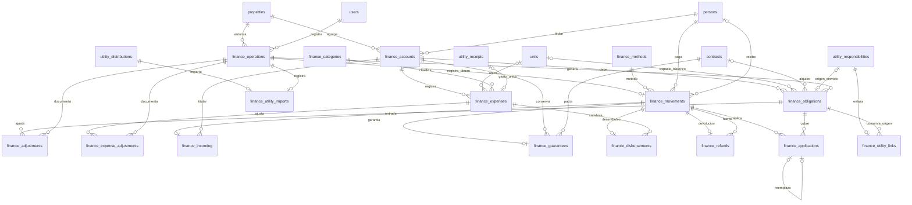

# Fase 4 — Por cobrar, pagos, deudas, anticipos, garantías y gastos

Entrega local del 7 de noviembre de 2026. Rama `phase-4-payments-finances`, creada desde `origin/main` en **`8b5e3d1`**, con fases 0–3 integradas. El identificador del commit de esta entrega se comunica al finalizar: este informe forma parte de ese commit. No se publica ni se integra la rama.

## Funciones entregadas

Las pantallas de **Pagos y gastos** incluyen Resumen económico, Por cobrar, Registrar pago, Deudas, Historial de pagos, Anticipos, Garantías, Gastos, Pagos realizados y Recuperación de servicios. Se mantienen contratos, reservas, personas, propiedades y servicios de fases anteriores.

- Generación explícita de alquileres con vista previa y condiciones del contrato. Diario inclusivo/por noches; semanas completas y parcialidad expresamente acordada; meses por calendario/aniversario, primer periodo proporcional/completo y vencimientos pactados.
- Los tramos finales incompletos y vencimientos personalizados sin decisión económica suficiente exigen revisión; no se interpreta texto libre como tarifa ni se inventa proporcionalidad.
- Obligaciones con identidad estable, origen, periodo, titular, casa/cuarto y moneda. Los saldos y estados se calculan desde importes originales, ajustes y aplicaciones válidas. Lo vencido no se copia como una deuda nueva al mes siguiente.
- Importación de servicios exclusivamente desde responsabilidades elegibles de la aprobación vigente de fase 3. No recalcula su regla de 15 días, no asigna la parte del propietario al inquilino ni agrega servicios a diario/incluidos.
- El gasto del proveedor puede registrarse/pagarse **antes de confirmar su distribución**, sin crear deudas de inquilinos. La importación posterior reutiliza el mismo gasto y los pagos ya registrados.
- Una entrada real puede cubrir varios conceptos; varios pagos pueden cubrir una obligación. El usuario selecciona importes, no hay reparto automático. El sobrante requiere elección explícita de anticipo/saldo a favor.
- Anticipos y créditos con titular, casa y moneda. Aplicarlos no registra una segunda entrada de dinero. Se pueden anular aplicaciones o devolver dinero realmente disponible con autorización.
- Garantías separadas del ingreso ordinario, con contrato, condiciones, aplicaciones autorizadas, retenciones y devoluciones parciales/completas. Nunca se trata garantía como capital anticrético.
- Gastos registrados separados de desembolsos. Pagos parciales, pagador real, destinatario y referencias externas. Pago directo documentado de inquilino al proveedor sin inventar caja del propietario.
- Ajustes, anulaciones y correcciones conservando originales y auditoría. Si baja una deuda cubierta, el exceso vuelve a su fuente original; una garantía vuelve a garantía, no se convierte automáticamente en crédito libre.
- Resumen por moneda desde los mismos datos de detalle, con entradas, garantías, disponibilidades, gastos, desembolsos, devoluciones y recuperación de servicios separados. No suma BOB y USD.
- Permisos de backend, operaciones transaccionales, identificadores de operación, huella de contenido, control de versiones contractuales y prevención de duplicados/repeticiones.

No hay procesos fiscales, impuestos, documentos comerciales/tributarios, capital o devolución de anticréticos, WhatsApp, recordatorios, gráficos avanzados ni PDF. Los comprobantes son **referencias a documentos externos**, sin almacenamiento de archivos en esta entrega.

## Modelo de datos

Se conservan las **25 tablas anteriores** y se agregan **16**: 41 tablas de aplicación, más `alembic_version`. Todas las FK nuevas usan `ON DELETE RESTRICT`. Importes persistidos `DECIMAL(14,2)`; fechas de calendario `DATE`; auditoría/registro en UTC. No se persisten saldos calculados ni se crean tablas mensuales de deudas acumuladas.

| Tabla | Función y campos principales |
| --- | --- |
| `finance_methods` | PK `id`, `name` único, `is_active`. Iniciales: Efectivo, Transferencia bancaria, Depósito, QR, Otros. |
| `finance_categories` | PK `id`, `name` único, `is_active`. Siete categorías iniciales, incluidas reparaciones y servicios básicos. |
| `finance_accounts` | PK `id`; `property_id`, `person_id`, `currency` forman clave única. Contexto de titular/casa/moneda, independiente de una cuenta bancaria. |
| `finance_operations` | PK `id`, `property_id`, `request_key` único, `action`, `payload_hash`, `result`, `created_by`, `created_at`. Idempotencia y resultado histórico, enlazado a auditoría. |
| `finance_obligations` | PK `id`, `account_id`, `unit_id` opcional histórico, `rent_contract_id` **o** `service_origin_id`, `period_start/end`, `original_amount`, `due_on`, `operation_id`. Origen obligatorio y exclusivo. |
| `finance_adjustments` | PK `id`, `obligation_id`, `delta` con signo, `new_due_on`, `new_period_end`, `operation_id`. No cambia el importe original. |
| `finance_expenses` | PK `id`, `account_id`, `unit_id`, `category_id`, `receipt_id` opcional único, `description`, `recorded_on`, `original_amount`, `due_on`, referencias/notas, `operation_id` único y `void_operation_id` opcional único. |
| `finance_expense_adjustments` | PK `id`, `expense_id`, `delta`, `operation_id`. Correcciones del total registrado, sin alterar desembolsos previos. |
| `finance_movements` | PK `id`, `amount`, `occurred_on`, `method_id`, `payer_id`, `beneficiary_person_id`, `beneficiary_label`, referencias/notas, `operation_id` único y `void_operation_id` opcional único. Un hecho real de dinero. |
| `finance_incoming` | PK/FK `movement_id`, `account_id`, `category: collection/advance`. Entrada ordinaria/anticipo. |
| `finance_guarantees` | PK/FK `movement_id`, `account_id`, `contract_id`, `conditions`, `retained_operation_id` opcional único. Dinero temporal de garantía, separado del ingreso ordinario. |
| `finance_disbursements` | PK/FK `movement_id`, `expense_id`, `is_direct`. Pago realizado: propio o directo del inquilino al proveedor. |
| `finance_refunds` | PK/FK `movement_id`, `source_movement_id`. Devolución real de un pago/anticipo o garantía disponibles. |
| `finance_applications` | PK `id`, `source_movement_id`, `obligation_id`, `amount`, `operation_id`, `void_operation_id`, `replaces_id` opcional único. Uso de dinero existente y cadena de correcciones. |
| `finance_utility_imports` | PK/FK `distribution_id`, `operation_id` único. Registra cada aprobación de servicio incorporada a finanzas. |
| `finance_utility_links` | PK/FK `responsibility_id`, `obligation_id`. Relaciona responsabilidades de revisiones sucesivas con la obligación que ajustan. |

La pertenencia del movimiento y su moneda se obtienen de su origen: entrada/garantía → contexto; desembolso → gasto → contexto; devolución → movimiento de origen. No se copian propiedad, titular y moneda en cada aplicación. El responsable de deuda puede ser distinto del pagador real.



El diagrama omite algunos vínculos repetidos a operaciones para facilitar su lectura. Un movimiento tiene exactamente uno de sus cuatro subtipos al crearse mediante el servicio transaccional; las FK impiden hijos huérfanos, pero la exigencia de un único subtipo y de hijos obligatorios no se garantiza por una FK simple desde el padre.

## Demostración de 1FN, 2FN y 3FN

Se analizan atributos relacionales y dependencias funcionales del dominio, no el número de campos/tablas. `K → resto` significa que la clave candidata determina todos los demás atributos. Los únicos con nulos solo constituyen claves alternativas en el subconjunto donde no son nulos; no se presentan como claves totales.

| Tabla | Claves/dependencias relevantes | Justificación individual |
| --- | --- | --- |
| `finance_methods` | `{id}` y `{name}` → resto. | 1FN: un nombre/estado por fila. 2FN: claves simples. 3FN: no hay dependencia entre atributos no clave. |
| `finance_categories` | `{id}` y `{name}` → resto. | Igual razonamiento: nombre/estado atómicos, sin dependencias parciales o transitivas. |
| `finance_accounts` | `{id}` y `{property_id,person_id,currency}` → resto. | Una relación por contexto, no listas de casas/personas. Ningún componente determina otro: una persona participa en varias casas y monedas. No hay atributos no clave aparte del identificador alternativo. |
| `finance_operations` | `{id}` y `{request_key}` → resto. | Una operación y su documento histórico por fila. Actor, acción, casa e instante no determinan una operación: se pueden repetir. No se duplica nombre del usuario o casa. Sin dependencias parciales/transitivas declaradas. |
| `finance_obligations` | `{id}` → resto. Para alquiler: alternativa `{rent_contract_id,period_start,account_id}`; para servicio, `service_origin_id` único. | Un importe original por contexto/periodo. El contrato actual no determina para todos sus periodos el titular/moneda/espacio financiero histórico: pueden existir sustituciones autorizadas y cambios de condiciones. Ningún componente aislado de la clave compuesta determina importe o fechas históricas. No se copia persona/moneda/casa desde el contexto ni servicio/proveedor desde el origen. |
| `finance_adjustments` | `{id}` y `{operation_id,obligation_id}` → resto. | Una operación puede ajustar varias obligaciones y una obligación tener muchos ajustes. El delta/fechas dependen de ambos; no de un componente aislado. El motivo/actor se obtienen de la operación, sin copiarse. |
| `finance_expenses` | `{id}` y `{operation_id}` → resto; `receipt_id` y `void_operation_id` alternativos cuando existen. | Un gasto por fila, con referencias atómicas. No se copian persona, moneda, nombre de categoría o datos variables del recibo actual. La descripción e importe originales son hechos del registro inicial, conservados a través de sus correcciones. Sin dependencias parciales/transitivas. |
| `finance_expense_adjustments` | `{id}` y `{operation_id,expense_id}` → resto. | El esquema permite agrupación de ajustes bajo una operación; delta depende del gasto dentro de esa operación. El servicio actual ajusta un gasto por solicitud. Sin copias del contexto/categoría del gasto ni motivo/actor de operación. |
| `finance_movements` | `{id}` y `{operation_id}` → resto; `void_operation_id` alternativo cuando existe. | Un importe real, fecha, método y participantes por fila. Pagar a una empresa/persona es un dato del hecho, independiente del responsable económico. No se almacena su saldo, moneda/contexto derivables del origen ni dirección redundante con el subtipo. Sin dependencias parciales/transitivas declaradas. |
| `finance_incoming` | `{movement_id}` → `account_id,category`. | Clave simple. Un contexto puede recibir cobros y anticipos diferentes: no determina categoría. No repite dinero, fecha, pagador o método del movimiento. |
| `finance_guarantees` | `{movement_id}` → resto; retención alternativa cuando existe. | Clave simple, condiciones atómicas. Un contrato puede tener entregas de garantía de distintos titulares/contextos: contrato solo no determina el contexto ni las condiciones de cada entrega. No repite el importe recibido. |
| `finance_disbursements` | `{movement_id}` → `expense_id,is_direct`. | Un gasto admite pagos propios y directos en ocasiones distintas: no determina `is_direct`. No se repite su contexto ni el importe del movimiento. |
| `finance_refunds` | `{movement_id}` → `source_movement_id`. | Solo dos referencias; una fuente admite varias devoluciones parciales. No hay atributos no clave adicionales que causen redundancia. |
| `finance_applications` | `{id}` y `{operation_id,source_movement_id,obligation_id}` → resto; `replaces_id` único cuando existe. | Una asignación por fuente/obligación/operación. Una operación de aplicación puede incluir varias fuentes y obligaciones, por lo que no determina una sola de ellas. Importe depende de la combinación completa; no repite titular, moneda, concepto o saldo. La relación sucesora conserva linaje, sin copiar la clasificación del dinero. |
| `finance_utility_imports` | `{distribution_id}` y `{operation_id}` se determinan mutuamente. | Dos claves simples; sin atributos no clave. No copia recibo/casa obtenibles desde la distribución. |
| `finance_utility_links` | `{responsibility_id}` → `obligation_id`. | Una responsabilidad confirmada enlaza una obligación; esta puede recibir enlaces de varias revisiones. No repite contrato/persona/importe de la responsabilidad. |

Por estas dependencias, los atributos son singulares, no hay dependencias parciales respecto de claves candidatas ni dependencias transitivas declaradas de atributos no primos; el esquema nuevo satisface 3FN bajo ese dominio. Los análisis de las 25 tablas anteriores permanecen en los informes de fases 1.1, 2 y 3.

**Frontera explícita:** `finance_operations.result` y `audit_events.details` son documentos históricos atómicos del dominio de auditoría, no tablas maestras ni relaciones de saldos actuales. No se afirma que cada miembro de su JSON sea una relación en 3FN. Los saldos operativos se calculan desde filas y FK; los documentos conservan contexto y resultado de una operación pasada, que no se actualizan al cambiar datos maestros.

No se crearon tablas adicionales de deuda acumulada o saldo a favor con cantidades duplicadas. Estas cantidades se derivan. Tampoco se usa 3FN como prueba de permisos, concurrencia o integridad monetaria: son propiedades diferentes y se verifican por separado.

## Integridad y criterios monetarios

Existen PK/FK, únicos por contexto, solicitud, periodo de alquiler/contexto y origen de servicio; únicos de enlaces/sucesores y operaciones de movimiento; `CHECK` de origen exclusivo, periodos, importes positivos/no negativos y categorías de entrada. Índices de vencimiento/fecha y los necesarios para FK de MySQL.

El control de sumas, mismo ámbito, compatibilidad de moneda/titular, subtipo único, disponibilidad y duplicados de referencias entre tablas lo realizan los servicios transaccionales, bloqueando la propiedad. Las lecturas críticas son actuales incluso en REPEATABLE READ. No se atribuyen estas reglas a restricciones SQL inexistentes entre varias tablas.

Fórmulas:

```text
Total exigible = original + ajustes
Saldo pendiente = total exigible − aplicaciones válidas
Disponible de fuente = dinero original válido − aplicaciones válidas − devoluciones válidas
Por pagar al proveedor = máximo(gasto ajustado − pagos realizados válidos, 0)
```

Una aplicación no añade dinero recibido. Una anulación revierte el registro erróneo; no afirma que se haya devuelto dinero real. La devolución requiere un movimiento propio autorizado. Una garantía recibida/devuelta permanece fuera del ingreso/gasto ordinario. Los importes del alquiler usan precisión decimal 48 y `ROUND_HALF_UP` a dos decimales; los servicios importan exactamente los centavos confirmados por fase 3. React trabaja con cadenas y enteros de centavos, sin cálculos monetarios `float`.

El resumen conserva cifras brutas separadas: dinero recibido y devoluciones no se confunden con ingreso neto; garantías se muestran aparte. “Servicios cubiertos” incluye aplicaciones autorizadas de dinero recibido anteriormente, incluso garantía, sin afirmar otra entrada de caja. La parte económica del propietario proviene del último reparto importado, no del gasto bruto ni de porcentajes de copropiedad.

## Ejemplos verificables

| Operación | Resultado |
| --- | --- |
| Diario a 100, entrada 1/salida 3 | 300 inclusivo; 200 por noches. Sin cargo extra de servicios. |
| Semanal a 100 durante 10 días, parcial proporcional expresamente acordado | Semana 100 + tramo 42,86 = 142,86. Sin acuerdo no hay importe definitivo. |
| Base mensual 150, primeros 14 días proporcionales | Mes de 28: 75,00; 29: 72,41; 30: 70,00; 31: 67,74. |
| Deuda 500, recibido 600 y sobrante autorizado | Una entrada de 600, aplicación 500 y saldo disponible 100. |
| Anticipo 300 aplicado después a obligación 500 | Pendiente 200; no se registran otros 300 recibidos. |
| Garantía 500: aplicar 100 y devolver 400 | Garantía disponible 0; deuda baja 100; devolución real 400. Ingreso ordinario por garantía: 0. |
| Gasto de tubería 250 | Registrar gasto deja desembolsado 0; pagos 100 y 150 dejan por pagar 0 y desembolsado 250. |
| Recibo eléctrico 300: responsabilidades 70,150,80 | Por cobrar a inquilinos 220, parte del propietario 80. Pagar 300 al proveedor no recupera todavía 220. |
| Luego se reciben 70 + 150 de los inquilinos | Una recuperación total de 220; gasto registrado 300, pago al proveedor 300, parte económica del propietario 80. |
| Inquilino paga directamente 150 al proveedor, documentado | Proveedor cubierto 150 y deuda de servicio cubierta 150; caja recibida/desembolsada del propietario 0. |
| Pago 800 erróneo, corregido a 600 | Se conserva 800 anulado y 600 válido; las aplicaciones del anterior se revierten. |
| Obligación de 500 cubierta, ajustada a 300 | Original 500, ajuste −200, exigible 300 y crédito de 200 en la fuente. No hay nuevo dinero ni devolución inventada. |
| Servicio cubierto 150, reparto sustituido exige 100 | Misma obligación ajustada a 100; dinero recibido sigue 150; 50 disponibles en su fuente. |

## Migración y recuperación

`0006_finances` depende de `0005_utilities`, crea 16 tablas y catálogos iniciales. No altera el esquema ni filas previas. Las migraciones 0001–0005 se conservan respecto de la base `8b5e3d1`.

Desde backend, con la URL configurada de forma segura:

```bash
../.venv/bin/alembic current
../.venv/bin/alembic upgrade head
../.venv/bin/alembic check
```

Se prueba base limpia y base en 0005 con datos ficticios en **las 25 tablas**, incluidas distribuciones confirmadas, lecturas, titulares, usuarios, hashes de contraseña, sesiones y permisos. Se comparan todas las filas antes/después y en descenso/subida `0006 → 0005 → 0006`.

Para datos que deban conservarse: detener escritores, hacer respaldo de esquema/datos y probar su restauración y migración en otra base antes de cambiar la original. MySQL puede confirmar DDL parcialmente. Si falla, detener uso, conservar evidencia y restaurar el respaldo verificado en una base separada; no simular éxito con `stamp` ni reintentar una migración parcial a ciegas.

El descenso a 0005 elimina **todos los datos financieros nuevos**; solo se verifica en bases descartables. No es una recuperación inocua de una base en uso. No se ejecutaron operaciones destructivas en datos reales ni otros proyectos.

## Permisos

| Perfil | Alcance y acciones |
| --- | --- |
| Administrador general | Todas las casas; gestiona además métodos/categorías. |
| Administrador de propiedad | Gestión económica y operaciones sensibles en casas asignadas. |
| Operador | Registro ordinario y generación inicial en casas asignadas; sin anulaciones, ajustes sensibles, devoluciones ni uso/retención autorizada de garantías. |
| Propietario | Consulta en las casas permitidas; sin mutaciones económicas. |

Los cuerpos e identificadores se cotejan contra la casa autorizada, además de ocultar acciones en React. Ser titular de un saldo histórico no concede acceso a una casa ajena. Los cambios de titularidad no transfieren fondos ni obligaciones a otro contexto silenciosamente.

## Archivos principales

- `backend/app/models/finances.py`, `schemas/finances.py`, `api/finances.py`: persistencia, entradas y rutas.
- `backend/app/services/finances.py`, `finance_periods.py`: reglas, operaciones, origen histórico y cálculos exactos.
- `backend/migrations/versions/0006_finances.py`: evolución incremental y catálogos.
- `frontend/src/pages/Finances.tsx`, `pages/finances/Forms.tsx`, `src/finances.ts`: pantallas, formularios y tipos/centavos.
- `App.tsx`, `styles.css`, `api.ts`: navegación, presentación y errores en español; importación del router/modelo en backend.
- `backend/tests/test_finances.py`, `test_migration_4.py`, `frontend/tests/Finances.test.tsx`, `frontend/e2e/finances.spec.ts`: verificación nueva. Fixtures anteriores solo actualizan restauración de `head` y comprobación de la revisión vigente.
- [API](phase-4-api.md), [pruebas y matriz de aceptación](phase-4-tests.md), [plan previo](phase-4-plan.md), capturas y registros de verificación.

No se añadieron dependencias de aplicación ni se modificaron los archivos de versiones de paquetes.

## Resultados y capturas

**276 pruebas backend, 34 React y 38 recorridos de navegador aprobados**, sin omisiones. Incluyen las 221 pruebas backend, 28 React y 28 de navegador de las fases anteriores. MySQL real descartable, migraciones limpias/pobladas, tres carreras con conexiones independientes, Alembic, TypeScript y compilación correctos. Se registraron 58 avisos de deprecación de dependencias, sin fallos. Después de la aclaración visual final se repitieron las 34 React, compilación y los diez recorridos financieros: todos pasaron.

Se guardaron 24 capturas reales y se inspeccionaron visualmente muestras de escritorio/móvil. La matriz de los 46 criterios, incidencias corregidas y registros completos está en [phase-4-tests.md](phase-4-tests.md).

La revisión de entrega examinó los archivos versionables, registros y capturas: sin `.env` privados, claves/tokens reconocidos, credenciales temporales de las pruebas ni volcados de bases. Los ejemplos de MySQL local/CI contienen únicamente valores públicos de desarrollo. Se comprobaron los enlaces, `git diff --check`, Black y las migraciones anteriores contra la base. No se presenta esta revisión como certificación integral de seguridad.

| Pantalla | Escritorio | Móvil |
| --- | --- | --- |
| Por cobrar | [Ver](screenshots/phase-4-escritorio-por-cobrar.png) | [Ver](screenshots/phase-4-movil-por-cobrar.png) |
| Registrar pago | [Ver](screenshots/phase-4-escritorio-registrar-pago.png) | [Ver](screenshots/phase-4-movil-registrar-pago.png) |
| Deudas | [Ver](screenshots/phase-4-escritorio-deudas.png) | [Ver](screenshots/phase-4-movil-deudas.png) |
| Historial | [Ver](screenshots/phase-4-escritorio-historial.png) | [Ver](screenshots/phase-4-movil-historial.png) |
| Anticipos | [Ver](screenshots/phase-4-escritorio-anticipos.png) | [Ver](screenshots/phase-4-movil-anticipos.png) |
| Garantías | [Ver](screenshots/phase-4-escritorio-garantias.png) | [Ver](screenshots/phase-4-movil-garantias.png) |
| Gasto registrado | [Ver](screenshots/phase-4-escritorio-gasto-registrado.png) | [Ver](screenshots/phase-4-movil-gasto-registrado.png) |
| Pagos realizados | [Ver](screenshots/phase-4-escritorio-pagos-realizados.png) | [Ver](screenshots/phase-4-movil-pagos-realizados.png) |
| Resumen | [Ver](screenshots/phase-4-escritorio-resumen.png) | [Ver](screenshots/phase-4-movil-resumen.png) |
| Recuperación de servicios | [Ver](screenshots/phase-4-escritorio-servicios.png) | [Ver](screenshots/phase-4-movil-servicios.png) |
| Pago directo documentado | [Ver](screenshots/phase-4-escritorio-pago-directo.png) | [Ver](screenshots/phase-4-movil-pago-directo.png) |
| Proveedor pagado antes del reparto | [Ver](screenshots/phase-4-escritorio-proveedor-sin-reparto.png) | [Ver](screenshots/phase-4-movil-proveedor-sin-reparto.png) |

## Probar en el navegador

1. Instala/inicia el entorno según [README](../README.md), migra a `head` y crea tu primer administrador con el comando interactivo. No hay contraseña predeterminada. En el entorno de pruebas solo se usaron cuentas temporales y datos ficticios.
2. Abre `http://localhost:5173` o el puerto 5173 del entorno. En **Pagos y gastos**, selecciona una casa que tenga personas y contratos registrados.
3. **Por cobrar → Generar alquileres**: elige contrato y horizonte, revisa importes, completa decisiones si faltan condiciones y confirma. Una segunda generación del mismo periodo no duplica la deuda.
4. **Registrar pago**: elige titular, quien entrega el dinero, importe, moneda y método. Introduce importes por concepto; revisa lo que quedará pendiente. Si sobra dinero elige explícitamente anticipo/saldo a favor. Confirma.
5. **Deudas**: filtra por persona, cuarto, contrato, periodo, concepto y moneda. Consulta original, ajustes, aplicaciones, vencimiento y saldo. **Historial de pagos** conserva registros válidos/anulados y aplicaciones.
6. **Anticipos**: usa **Aplicar saldo** o, como administrador, registra una devolución real. **Garantías** permite recibir, aplicar con autorización/motivo, retener y devolver sin tratar el capital como renta.
7. **Gastos → Registrar gasto**: registra una reparación de 250. El desembolso es cero hasta usar **Registrar pago del gasto**. Prueba 100 y después 150 para verificar pagos parciales.
8. **Recuperación de servicios**: registra el gasto de un recibo externo, incluso antes de repartirlo, y paga al proveedor cuando ocurra. Importa luego el reparto confirmado: conserva el gasto y añade únicamente obligaciones de inquilinos.
9. Para pago directo del inquilino, abre el pago del gasto del recibo, marca la opción correspondiente, identifica pagador/comprobante y obligaciones exactas. Comprueba que no se inventó dinero recibido por el propietario.
10. Como administrador, usa ajustes/anulaciones con motivo. Para corregir un pago, anula el erróneo y registra el correcto. Comprueba saldos y ambos registros en el historial. El **Resumen económico** separa monedas y usa los mismos importes que los detalles.

## Límites y decisiones conservadoras

- Lecturas/condiciones ambiguas siguen pendientes en fase 3; no se omite su revisión para crear deudas. No se interpreta texto libre para precios parciales ni vencimientos personalizados.
- El espacio de una obligación conserva su referencia histórica. Si un contrato cambia de espacio, no se traslada una deuda automáticamente; deben revisarse sus obligaciones y utilizar ajustes/contratos apropiados. Los cambios de responsable/moneda requieren autorización explícita, sin transferir fondos.
- Se registran referencias de comprobantes, sin subida/almacenamiento de archivos, extracción automática ni integraciones bancarias.
- Un exceso de desembolso por reducción del gasto se muestra como devolución pendiente del proveedor. Un exceso de pago directo del inquilino se mantiene como devolución externa pendiente; no se registra automáticamente como efectivo o crédito libre del propietario. El registro de devoluciones reales del proveedor requiere un flujo externo específico; no se afirma que ya hayan ocurrido.
- No se transfieren saldos entre titulares/casas/monedas ni se convierten monedas. Se rechazan operaciones incompatibles.
- La clasificación de recuperación identifica aplicaciones válidas de dinero previamente recibido; no constituye un estado de resultados por periodo ni un reconocimiento tributario. Los reportes avanzados se mantienen fuera de fase 4.
- Las reglas entre varias filas presuponen escrituras por los servicios autorizados. La aplicación no garantiza esas reglas frente a modificaciones SQL externas con permisos amplios.
- Pruebas funcionales y carreras MySQL reales no equivalen a certificación de carga, seguridad integral o accesibilidad con personas mayores. Estas revisiones permanecen previstas en sus fases correspondientes.

Los resultados definitivos y capturas quedan enlazados en [phase-4-tests.md](phase-4-tests.md). La fase 5 requiere aprobación posterior.
