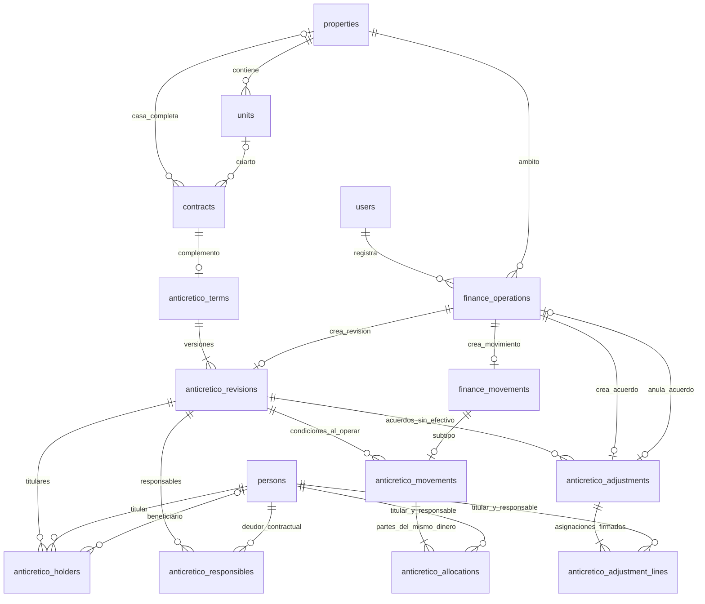

# Fase 5: anticréticos, capital y restituciones

Rama de revisión local: `phase-5-anticreticos-capital`, basada en `origin/main` (`b4450db7293c482313833377a5fa19fbe4bdf45b`). Sin publicación, merge ni fase 6. Dependencias y aceptación previas: [plan](phase-5-plan.md). Contratos HTTP: [API](phase-5-api.md). Resultados, matriz de aceptación y capturas: [pruebas](phase-5-tests.md).

## Funcionalidades

El módulo **Anticréticos** completa los contratos de modalidad `anticretico` existentes. No crea otra ocupación, no guarda el capital en `contracts.price` ni activa contratos mixtos. Se puede trabajar con una casa completa o con un cuarto. Un contrato anterior sin información económica conserva sus datos y muestra **Información económica pendiente**; no se inventan dinero, personas, porcentajes ni fechas.

Se registran condiciones económicas versionadas, capital acordado, fechas previstas, referencias externas, titulares con derecho a restitución, beneficiarios autorizados y responsables contractuales. Las asignaciones de cada grupo se escriben expresamente y suman el capital acordado. Ser propietario firmante, ocupante, pagador o titular no implica ser responsable de devolver; `contract_owners.share` y `property_owners.share` no se usan para repartir capital.

Entregas y devoluciones reales admiten importes parciales, método, fecha, pagador físico y receptor distintos, comprobante y referencia externa. Cada movimiento asigna su importe por pareja titular/responsable. Se conserva el historial de condiciones, movimientos anulados y acuerdos que modifican la restitución. No se borran movimientos para corregirlos.

La pantalla ofrece listado, detalle, titulares y responsables, movimientos e historial, servicios independientes, resumen por moneda y consulta de próximos vencimientos/vencidos. Las acciones sensibles presentan confirmación; la devolución muestra importe, pagador, receptor y saldo antes/después. La navegación conecta Contratos y Pagos y gastos.

## Cantidades y separación financiera

| Cantidad de la API | Significado |
| --- | --- |
| `capital_agreed` | Capital del acuerdo vigente; no demuestra una entrega. |
| `capital_received` | Suma de entregas reales válidas, sin descontar devoluciones. |
| `capital_to_receive` | Máximo entre acordado menos recibido y cero. |
| `capital_returned` | Suma de devoluciones reales válidas. |
| `capital_adjustments` | Suma de acuerdos no monetarios vigentes; cero en una reasignación. |
| `capital_pending` | Recibido + ajustes − devuelto. Se verifica también por pareja y fecha. |

Los importes usan `Decimal` y `DECIMAL(14,2)`, nunca `float`. La entrada exige como máximo dos decimales: no redondea silenciosamente una entrega con más precisión. Las sumas y asignaciones deben coincidir exactamente. React calcula la vista previa con centavos `BigInt`; el servidor vuelve a validar. No se convierten ni suman monedas distintas.

Una entrega/restitución genera **una** fila `finance_movements` y su subtipo `anticretico_movements`, con asignaciones; no genera `finance_incoming`, `finance_guarantees`, `finance_disbursements`, renta ni gastos. Las aplicaciones, devolución y anulación ordinarias rechazan esos movimientos. La anulación de capital usa su operación específica y verifica todas las dependencias.

Pagos y gastos muestra cinco cantidades de capital separadas (`capital_agreed`, `capital_received`, `capital_returned`, `capital_adjustments`, `capital_pending`) calculadas por el mismo servicio. Sus entradas ordinarias, desembolsos ordinarios, garantías y créditos no incluyen capital. No se altera el significado previo de las cifras financieras.

Ejemplo verificado:

| Paso | Acordado | Recibido real | Devuelto real | Pendiente de recibir | Pendiente de devolución |
| --- | ---: | ---: | ---: | ---: | ---: |
| Guardar condiciones | 70.000 | 0 | 0 | 70.000 | 0 |
| Entrega de 20.000 | 70.000 | 20.000 | 0 | 50.000 | 20.000 |
| Entregas de 30.000 y 20.000 | 70.000 | 70.000 | 0 | 0 | 70.000 |
| Devoluciones de 10.000 y 15.000 | 70.000 | 70.000 | 25.000 | 0 | 45.000 |

Otro caso: una entrega errónea de 20.000 se anula y se registra 15.000; una devolución errónea de 10.000 se anula y se registra 5.000. Quedan recibido 15.000, devuelto 5.000 y pendiente 10.000, conservando las cuatro filas. Una reducción documentada posterior de 10.000 lleva el pendiente a cero **sin afirmar otra devolución real**.

## Fechas, cambios y liquidación

Las fechas `contracts.start_date`, `end_date`, `actual_end_date`, entrega prevista, restitución pactada y fechas reales de movimientos son conceptos distintos. Finalizar la ocupación conserva el capital pendiente. Liquidar el capital no finaliza la ocupación. La prórroga llama a la operación de Contratos y verifica disponibilidad; no cambia automáticamente las condiciones económicas.

Toda modificación de condiciones crea una revisión inmutable, exige administrador, motivo y documento. Cambiar el capital acordado no reescribe dinero recibido o devuelto ni traslada obligaciones. Una reducción por debajo de lo recibido exige reconocimiento expreso y muestra `received_above_agreed`; la restitución no disminuye por ese solo paso.

Los acuerdos no monetarios tienen fecha efectiva, motivo, referencia externa y asignaciones firmadas. `settlement` reduce la obligación, `reassignment` la traslada entre personas con total cero y `additional` registra otra obligación expresamente pactada. No generan efectivo, intereses ni penalidades automáticas. Una obligación adicional documentada puede permitir devolver un importe superior al capital recibido; se identifica separadamente del efectivo recibido.

No se retiran titulares/responsables con saldo pendiente sin una reasignación explícita previa. El cupo para nuevas entregas considera el capital reasignado y las partes vigentes. La anulación de un acuerdo o movimiento vuelve a comprobar la cronología y todos los saldos; se rechaza si deja una pareja con capital negativo o permite una devolución anterior al capital disponible. La cronología tiene resolución diaria, con neteo dentro del mismo día.

Una vez registradas condiciones económicas, el espacio, la modalidad y la moneda del contrato quedan protegidos por backend. Para otro espacio/moneda/modalidad se requiere otro contrato, preservando el anterior. Las fechas de ocupación siguen cambiándose mediante los flujos existentes.

## Servicios

Los recibos, consumos, repartos, obligaciones y cobros de servicios usan las fases 3 y 4. Para el anticresista se conserva la regla de 14/15/16 días dentro del periodo real del recibo; servicios incluidos o a cargo del propietario no se convierten en deuda del ocupante.

El detalle de capital muestra las obligaciones de servicios de ese contrato, pero devolver o liquidar el capital no las paga. No existe descuento automático de servicios, daños o gastos contra el capital. Esta fase tampoco implementa compensaciones cruzadas: un acuerdo de restitución no crea una aplicación ni cancela una deuda ordinaria. Si las partes requieren una compensación, necesitará un flujo específico autorizado posteriormente.

## Tablas y relaciones

Se conservan las **41 tablas anteriores**. `0007_anticreticos` añade ocho: **49 tablas de aplicación**, más `alembic_version`. Todas las FK nuevas usan `ON DELETE RESTRICT`.

| Tabla | Campos, claves y función |
| --- | --- |
| `anticretico_terms` | `contract_id INTEGER` PK/FK→`contracts.id`; `version INTEGER NOT NULL DEFAULT 1`. Identidad económica y versión para concurrencia. Contrato 1→0..1 condiciones. |
| `anticretico_revisions` | `id INTEGER` PK; `contract_id INTEGER` FK→terms; `revision INTEGER`; `agreed_capital DECIMAL(14,2)`; `expected_delivery_on DATE NULL`; `restitution_on DATE NULL`; `allow_early_return BOOLEAN DEFAULT 0`; `conditions TEXT`; `document_reference VARCHAR(500) NULL`; `notes TEXT NULL`; `operation_id INTEGER` FK→finance_operations, UNIQUE. Una identidad tiene 1..N revisiones creadas por aplicación. |
| `anticretico_holders` | PK compuesta (`revision_id INTEGER` FK→revisions, `person_id INTEGER` FK→persons); `assigned_amount DECIMAL(14,2)`; `beneficiary_person_id INTEGER NULL` FK→persons. Revisión 1→0..N titulares. |
| `anticretico_responsibles` | PK compuesta (`revision_id INTEGER` FK→revisions, `person_id INTEGER` FK→persons); `assigned_amount DECIMAL(14,2)`. Revisión 1→0..N responsables. |
| `anticretico_movements` | `movement_id INTEGER` PK/FK→finance_movements; `revision_id INTEGER` FK→revisions; `kind VARCHAR(20)`. Un movimiento real tiene 0..1 subtipo de capital. Revisión 1→0..N movimientos. |
| `anticretico_allocations` | `id INTEGER` PK; `movement_id INTEGER` FK→anticretico_movements; `holder_id INTEGER`, `responsible_id INTEGER` FK→persons; `amount DECIMAL(14,2)`. Movimiento 1→1..N partes por aplicación. |
| `anticretico_adjustments` | `id INTEGER` PK; `revision_id INTEGER` FK→revisions; `kind VARCHAR(20)`; `effective_on DATE`; `document_reference VARCHAR(500)`; `operation_id INTEGER` FK UNIQUE→finance_operations; `void_operation_id INTEGER NULL` FK UNIQUE→finance_operations. Acuerdo no monetario con anulación trazable. |
| `anticretico_adjustment_lines` | PK compuesta (`adjustment_id INTEGER` FK→adjustments, `holder_id INTEGER`, `responsible_id INTEGER` FK→persons); `delta DECIMAL(14,2)` firmado. Acuerdo 1→1..N líneas por aplicación. |

Salvo campos marcados `NULL`, los campos son obligatorios. No se copian nombres personales, moneda, propiedad, usuario/instante de operación ni importes reales en los subtipos. El contrato resuelve la propiedad directamente o mediante su unidad. El usuario/instante/motivo procede de `finance_operations` y auditoría.

Restricciones adicionales: `UNIQUE(contract_id,revision)`; índice `ix_anticretico_restitution_date(restitution_on)`; `UNIQUE(movement_id,holder_id,responsible_id)`; capital acordado > 0; asignaciones acordadas ≥ 0; partes de movimiento > 0; líneas de ajuste ≠ 0; tipos de movimiento y ajuste limitados por `CHECK`. MySQL crea índices de soporte para FK. Las PK, índices y restricciones anteriores permanecen intactos.

Las sumas entre filas, pertenencia a partes del acuerdo, coherencia contrato/propiedad, modalidad, autorización de beneficiario, exclusividad de subtipos, versiones y presupuestos requieren transacciones del servicio; no se presentan como restricciones SQL de fila. Una escritura SQL externa puede saltarse esos controles y no es un mecanismo admitido de registro económico.

La cardinalidad mínima de revisiones y partes positivas es una invariante de la aplicación; una FK sola no obliga a que exista al menos un hijo. El contrato apunta a **casa XOR unidad**, con el `CHECK` preexistente; el diagrama representa ambas alternativas opcionales.

## Demostración de normalización

Se enumeran las DF del dominio implementado. `K → resto` significa que una clave candidata mínima determina todos los atributos restantes de esa relación. La unicidad de una FK anulable solo aplica al subconjunto no nulo y no la convierte en clave candidata total.

| Relación | Claves candidatas y DF no triviales | 1FN | 2FN | 3FN |
| --- | --- | --- | --- | --- |
| `anticretico_terms` | `{contract_id} → version`. | Un valor escalar por atributo; sin grupos. | Clave simple; no hay parte propia determinante. | No hay dos atributos no clave con dependencia transitiva. |
| `anticretico_revisions` | `{id}`, `{contract_id,revision}` y `{operation_id}` son claves candidatas; cada una → resto. `contract_id` no determina capital, fechas o condiciones de todas sus revisiones. | Una versión de condiciones por fila; personas en relaciones separadas. | Ni contrato solo ni número de revisión solo determinan los atributos del acuerdo versionado. | No almacena `property_id`, `currency`, actor ni instante derivados de otras referencias; ningún no clave determina otro atributo no primo de esta relación. |
| `anticretico_holders` | `{revision_id,person_id} → assigned_amount,beneficiary_person_id`. | Un titular y un beneficiario por fila. | Ni revisión sola ni persona sola determina su parte o autorización. | `person_id → beneficiary_person_id` NO es una DF: la autorización puede variar entre contratos y revisiones. Tampoco `assigned_amount` determina beneficiario. No hay dependencia transitiva. |
| `anticretico_responsibles` | `{revision_id,person_id} → assigned_amount`. | Una parte por responsable. | Necesita ambas columnas; no hay porcentaje global por persona. | Su único atributo no clave no determina otro no clave. |
| `anticretico_movements` | `{movement_id} → revision_id,kind`. | Un subtipo por evento. | Clave simple. | Revisión no determina tipo: hay entregas y devoluciones bajo las mismas condiciones. No se repite el importe, moneda, pagador ni fecha del evento padre. |
| `anticretico_allocations` | `{id}` y `{movement_id,holder_id,responsible_id}` → resto. | Una cantidad para una pareja en un movimiento. | Movimiento puede tener varias parejas; titular/responsable pueden participar en varios movimientos. Ningún subconjunto propio determina importe. | No contiene capital acordado, nombres ni moneda. El importe de una pareja no se deriva de las partes acordadas: la entrega puede ser parcial. |
| `anticretico_adjustments` | `{id}` y `{operation_id}` → resto. `void_operation_id` es único solo cuando existe. | Una clase/fecha/documento por acuerdo, líneas separadas. | Claves candidatas simples. | Una revisión admite varios tipos, fechas y documentos. No se copian contrato, importe agregado, actor ni instante. |
| `anticretico_adjustment_lines` | `{adjustment_id,holder_id,responsible_id} → delta`. | Una variación firmada por pareja. | Cada componente es necesario: ninguna parte propia determina la variación. | Solo un atributo no clave; no existe cadena transitiva de atributos no primos. |

Para toda DF no trivial de las relaciones nuevas bajo estas reglas, el determinante es una superclave. No existen grupos repetitivos, dependencias parciales de atributos no primos ni dependencias transitivas declaradas: se demuestra al menos **3FN** para este esquema relacional y dominio. No se afirma una normalización universal ante reglas futuras no definidas.

Las ocho tablas iniciales conservan su análisis individual en [fase 1.1](phase-1.1-normalization.md); las cinco de ocupación en [fase 2](phase-2.md), doce de servicios en [fase 3](phase-3.md) y dieciséis financieras en [fase 4](phase-4.md). No se alteran sus columnas, DF, claves ni restricciones. La relación entre personas y usuarios sigue siendo la de fase 1.1: una persona puede existir sin cuenta y el nombre no se duplica en `users`.

`finance_operations.result` y `audit_events.details` continúan siendo documentos inmutables de resultado/evidencia, no fuentes maestras de saldos. Pueden capturar importes/condiciones de una operación pasada deliberadamente. La afirmación de 3FN se refiere a las relaciones operativas y sus atributos, no a cada miembro interno del JSON histórico. No se usa ese JSON para reconstruir capital vigente.

La normalización evita insertar copias de personas o cuentas para registrar un derecho, actualizar capital/currency en varios lugares o perder entregas al cambiar condiciones. Las FK RESTRICT evitan borrar personas/revisiones referenciadas. Versionado, auditoría, permisos, control de sumas y concurrencia son controles funcionales adicionales, no pruebas de normalización.

## Permisos, concurrencia y trazabilidad

| Rol | Consulta | Entregas | Condiciones, devoluciones, acuerdos y anulaciones |
| --- | --- | --- | --- |
| Administrador general | Todas las casas | Sí | Sí |
| Administrador de propiedad | Casas asignadas | Sí | Sí |
| Operador | Casas asignadas | Sí, con condiciones completas | No |
| Propietario | Casas de su persona vinculada | No | No |

El backend comprueba sesión, rol, propiedad, contrato y pertenencia de movimientos/acuerdos. Cambiar identificadores no concede acceso. Se mantienen autenticación y sesiones existentes, sin nuevas credenciales ni mecanismos de acceso.

Cada mutación reutiliza `finance_operations`: bloqueo de la propiedad, lectura actual MySQL `FOR UPDATE`, huella SHA-256, `request_key` único y resultado original. La misma solicitud devuelve el resultado original aunque las versiones ya hayan avanzado. Misma clave con otros datos produce 409. Otra clave con método/referencia externa ya válida en esa casa produce 409, incluso entre módulos ordinarios y capital; después de anular se puede registrar la corrección conservando historia.

`expected_version` del capital y `expected_contract_version` protegen formularios obsoletos. La propiedad se bloquea antes de comprobar ambos saldos, compartiendo orden con contratos, servicios y finanzas. La transacción incluye operación, movimiento/asignaciones o acuerdo, versión y `audit_events`. Un error no deja una entrega parcial. Las pruebas de carreras usan MySQL real y conexiones independientes; resultados en el informe de pruebas.

## Migración y recuperación

Migración nueva: `backend/migrations/versions/0007_anticreticos.py`, padre `0006_finances`. Crea únicamente las ocho tablas anteriores; no cambia ni rellena las 41 previas. Los anticréticos existentes no reciben importes supuestos. SQLAlchemy y Alembic importan explícitamente el módulo de modelos nuevo.

Aplicación revisada desde `backend`: `../.venv/bin/alembic upgrade head`. Después: `../.venv/bin/alembic current` y `../.venv/bin/alembic check`. Las pruebas separadas de fase 5 exigen `PHASE5_MIGRATION_DATABASE_URL` MySQL con base terminada en `_test` y la vacían; nunca usar datos que deban conservarse.

Se probó desde cero, desde `0006_finances` con **todas las 41 tablas pobladas**, bajada a 0006 y nueva subida. Se compararon todas sus filas antes/después, incluyendo personas, hashes de contraseñas, sesiones, permisos, contratos, repartos, pagos y auditoría; el contrato anticrético previo sin capital continúa consultable.

Antes de una migración operativa: detener escritores, verificar un respaldo y conservar revisión/esquema actuales. MySQL no revierte todo DDL automáticamente. Si falla una creación, no marcar manualmente la revisión como aplicada: inspeccionar `alembic_version` y las tablas creadas; en una copia descartable reproducir el fallo y recuperar desde respaldo verificado o completar la reparación controlada. No ejecutar una bajada ciega sobre datos reales.

`alembic downgrade 0006_finances` elimina las ocho tablas nuevas; si ya se usaron, requiere antes exportar/verificar su historial y aprobación operativa. Los movimientos de capital viven en tablas financieras anteriores: bajar después de registrar capital dejaría movimientos sin su subtipo interpretable por la versión antigua. Para volver a la versión anterior tras uso real, restaurar **todo** el respaldo coherente previo a 0007 y conciliar cualquier operación posterior. Las pruebas de bajada se hicieron antes de registrar capital, conservando los 41 conjuntos históricos; no se promete downgrade sin pérdida del módulo nuevo.

## Archivos principales

- `backend/app/{models,schemas,services,api}/anticreticos.py`: esquema, validaciones, cálculos, permisos y ocho rutas.
- `backend/app/services/finances.py`: contexto/subtipo de capital, resumen separado y protección de anulación ordinaria.
- `backend/app/services/tenancy.py`: protege espacio/modalidad/moneda tras registrar condiciones económicas.
- `backend/migrations/versions/0007_anticreticos.py`, `migrations/env.py`, `app/main.py`: migración y registro del módulo.
- `backend/tests/test_anticreticos.py`, `test_migration_5.py`; ajustes de head en regresión de migración e integración.
- `frontend/src/anticreticos.ts`, `pages/Anticreticos.tsx`, `pages/anticreticos/{ConditionsForm,CapitalForm}.tsx`: tipos y pantallas.
- `frontend/src/{App,api,finances}.ts*`, `pages/{Tenancy,Finances}.tsx`, `pages/tenancy/ContractWizard.tsx`: navegación, mensajes y resumen.
- `frontend/tests/Anticreticos.test.tsx`, `frontend/e2e/anticreticos.spec.ts`, configuración CI, documentación y evidencias.

## Probar desde el navegador

1. Sigue instalación, migración y arranque del [README](../README.md), con una base de desarrollo propia y tu cuenta administradora; no existe contraseña inicial predeterminada.
2. Registra personas, una propiedad y sus cuartos. En **Contratos**, crea un contrato vigente de modalidad **Anticrético**, eligiendo casa completa o cuarto. La tarifa ordinaria queda vacía.
3. En su detalle pulsa **Ver capital del anticrético**, o entra en **Anticréticos**, selecciona la casa y **Ver capital del contrato**.
4. Pulsa **Completar capital acordado**: 70.000, moneda contractual, fechas previstas, titulares, beneficiarios autorizados y responsables con sus importes; escribe condiciones y documento. Revisa y guarda. Recibido y pendiente de devolución deben seguir en cero.
5. Registra entregas reales de 20.000, 30.000 y 20.000. Elige pagador/receptor, método y las partes del movimiento. Tras cada registro revisa los saldos; al final recibido debe ser 70.000.
6. Si el acuerdo permite devolución anticipada, registra 10.000 y 15.000 con receptor autorizado y responsable explícito. Antes de confirmar revisa el saldo posterior. Deben quedar 45.000 pendientes.
7. Consulta **Titulares y responsables**, **Movimientos e historial**, **Capital y cierre**, **Servicios básicos**, **Resumen del capital** y **Vencimientos**. Pagos y gastos conserva las cantidades de capital separadas de alquiler/garantías.
8. Para corregir, anula el movimiento con motivo y registra el correcto. Si hay devoluciones dependientes, el sistema puede exigir corregirlas primero. Los originales permanecen visibles.
9. **Modificar condiciones económicas** conserva versiones. **Prorrogar ocupación** valida disponibilidad. Finaliza la ocupación desde Contratos; el capital pendiente sigue visible.
10. Repite la consulta con propietario u operador de esa casa: propietario solo consulta; operador registra entregas ordinarias y no tiene devoluciones, acuerdos sensibles ni anulaciones.

## Límites y continuidad

Se implementan referencias documentales, sin carga de archivos ni generación de instrumentos jurídicos. La aplicación registra condiciones; no certifica su validez legal. No hay compensación automática o manual cruzada con servicios, intereses, reajustes o penalidades automáticos. Cada movimiento físico tiene un pagador y un receptor; transferencias físicas distintas se registran separadas, con asignaciones explícitas.

Los vencimientos son consultas, sin WhatsApp ni recordatorios. No se añadieron reportes PDF, gráficos avanzados, emisión tributaria ni funciones de otras fases. Tampoco se modifica Pisco Ñawi ni se instala en la computadora del usuario. Continúan los límites operativos/seguridad documentados en fases anteriores (HTTPS en producción, recuperación de cuentas y revisión de accesibilidad con usuarios mayores pendientes de sus fases).

Las pruebas definitivas y la confirmación de regresión de las fases 0–4 se documentan en [phase-5-tests.md](phase-5-tests.md). La fase 6 queda pendiente de aprobación explícita.
