# Fase 6 · Recordatorios y WhatsApp asistido

Rama local `phase-6-reminders-whatsapp`, basada en `e078aaf64da189657d6435939309fb0f2e0b75ae` de `origin/main`. Se conserva la corrección E2E de catálogos de fase 5. [Preparación previa](phase-6-plan.md), [resultados y matriz de aceptación](phase-6-tests.md), [API](phase-6-api.md).

## Funcionalidades y fuentes

La sección **Recordatorios** consulta saldos vigentes. Consultar o actualizar no inserta obligaciones, movimientos ni avisos persistidos. La primera revisión o comunicación crea una identidad de seguimiento, sin copiar su saldo. Preparar mensajes, abrir WhatsApp y confirmar manualmente son operaciones distintas.

| Aviso | Fuente autorizada | Interpretación |
| --- | --- | --- |
| Alquiler | `finance_obligations`, ajustes y aplicaciones válidas de fase 4 | Pendiente actual; nunca suma otra deuda por meses anteriores |
| Servicio | Obligación importada de una distribución confirmada | Solo responsabilidad económica real del ocupante; respeta excepciones de fase 3 |
| Recuperación | La misma obligación, más desembolso vigente del responsable del gasto | Cambia la descripción del aviso, conserva su identidad; no duplica el gasto ni recibe dinero |
| Proveedor | Revisión del recibo externo; si ya se registró gasto, su saldo y pagos reales | Un recibo y su gasto vinculado producen un solo aviso de proveedor |
| Otros gastos | Gasto registrado y desembolsos vigentes | Importe registrado, efectivamente pagado y pendiente separados |
| Contrato | Contrato actual, estado y prórrogas de fase 2 | Fecha pactada; cancelar/finalizar cierra este aviso, sin cancelar deudas |
| Anticrético | Libro de fase 5, por pareja titular/responsable | Capital realmente recibido, devuelto, ajustado y pendiente; independiente de ocupación y renta |
| Pago reportado | Afirmación registrada y sus decisiones, contrastadas con movimientos de fase 4 | No confirma dinero; verificar vincula una entrada real existente |

Se reutilizan `finances.state/obligation_values` y `anticreticos.detail`. El backend conserva `Decimal`; los importes viajan como cadenas. Cada moneda permanece separada. Si se anula un pago, se libera una aplicación o se ajusta el saldo, el aviso cambia en la siguiente consulta. Un pago efectuado por otra persona no se rotula como desembolso del propietario por inferencia.

Las fechas se calculan en `America/La_Paz` con `tenancy.today()`. La API devuelve la fecha de negocio: el navegador no decide por sí solo si algo está vencido. Los instantes de auditoría se guardan en UTC. Un origen sin fecha muestra revisión interna; no se inventa vencimiento ni se ofrece un mensaje económico engañoso. Un pago reportado muestra su fecha comunicada y su revisión pendiente.

## Atención y prevención de duplicados

Identidades estables: `debt:<obligación>`, `receipt:<recibo>`, `expense:<gasto>`, `contract:<contrato>`, `capital:<contrato>:<titular>:<responsable>` y `report:<reporte>`. La obligación identifica su periodo y persona responsable. Cambiar saldo, vencimiento o pasar de servicio a recuperación no multiplica la identidad.

La consulta incluye avisos activos y aquellos con historial. Los saldados se retiran de la atención activa; si hay historial se muestran resueltos. Un origen futuro fuera de ventana queda programado, no pagado. Si terminó la ocupación y sigue pendiente capital con restitución futura, se pide revisión interna conservando la fecha pactada; no se declara vencimiento anticipado.

La atención es personal: cada usuario revisa, pospone o reabre su propio seguimiento. **Revisado no significa pagado**. Se reactiva en los hitos configurados (por defecto 7, 3, 1 y el vencimiento), cada nuevo día de atraso y ante cambios materiales. Entre 7 y 6 días puede conservarse revisado; al llegar a 3 vuelve a requerir atención. Posponer está limitado por propiedad (1–30 días de máximo configurable) y nunca cambia la fecha económica. Otra persona puede seguir necesitando revisar el mismo aviso.

Las mutaciones llevan `request_key` y, cuando corresponde, `expected_version` y huella del origen. El backend bloquea primero la propiedad, en el mismo orden que finanzas y capital. Se alinearon también las entradas de lectura crítica de `finances.state` y `anticreticos.detail/summary/listing`: el navegador y una prueba MySQL reprodujeron interbloqueos 1213 cuando esas lecturas adquirían primero cuentas, movimientos o contratos. El cambio solo ordena bloqueos; no altera cálculos económicos. La misma solicitud devuelve su resultado original; reutilizar la clave para contenido, acción, casa o usuario diferente devuelve 409. Las restricciones únicas complementan este bloqueo. Se probaron carreras reales con conexiones MySQL independientes, no solo promesas en el navegador.

## Consentimiento y mensajes

Una aceptación corresponde a **persona + propiedad + propósito + número**. Propósitos: pagos/servicios, coordinación contractual, restitución de capital y revisión de pagos reportados. La aceptación se registra expresamente, con fecha, medio, observaciones y actor; el teléfono guardado no concede autorización. No se crean consentimientos al migrar.

Los números se reutilizan de `persons.phone/whatsapp`. `phonenumberslite==9.0.43` valida numeración internacional sin acceder a internet; se añadió para evitar reglas caseras incorrectas por país. La opción de agregar 591 requiere elección expresa y ocho dígitos locales. Un número inválido, cambiado o ajeno al contacto bloquea la preparación/apertura.

Cada renovación crea una aceptación nueva. La anterior conserva número y datos aceptados, y queda revocada/sustituida. Una relación de vigencia identifica la aceptación actual. Los mensajes antiguos siguen vinculados a su aceptación original: renovar a otro número no reescribe el destinatario histórico.

Flujo exacto:

1. Seleccionar aviso y destinatario permitido por ese origen. Un contacto de la misma casa no recibe automáticamente acceso a todos los asuntos.
2. Obtener propuesta con datos actuales, número y consentimiento; revisar y editar texto.
3. Guardar preparación. La huella de propuesta comprueba también que número aceptado y plantilla siguen siendo los revisados; si cambiaron, exige generar y revisar el texto otra vez. Todavía no existe apertura ni confirmación de envío.
4. Pulsar **Abrir WhatsApp** y confirmar. El navegador reserva una pestaña y el backend vuelve a comprobar permisos, origen, saldo/fecha, destinatario, número, consentimiento y plantilla.
5. Si todo sigue vigente, obtener exclusivamente `https://wa.me/NUMERO?text=...`, codificado con UTF-8. Si cambió, generar explícitamente texto actualizado. El texto anterior permanece en el historial.
6. Registrar apertura con la autorización recién obtenida. Un bloqueo de ventanas no registra apertura. El usuario realiza personalmente el envío en WhatsApp.
7. Volver y pulsar **Confirmar que yo lo envié** o **Registrar como no enviado**. Una corrección posterior agrega un evento con motivo, sin borrar la confirmación anterior.

**Abrir WhatsApp no demuestra envío, entrega ni lectura. La confirmación manual tampoco demuestra entrega o lectura.** Copiar texto no registra envío. No existen estados automáticos de recibido, entregado o leído. Un enlace ya abierto queda fuera del control del sistema; revocar impide obtener nuevas autorizaciones, pero no puede retirar texto ya visto en una aplicación externa.

`LinkProvider` es únicamente una frontera de preparación de enlaces. `ClickToChat` no posee cliente de envío, tokens, temporizadores, webhook ni conexión a WhatsApp Business Platform. En las pruebas, el dominio se intercepta localmente: no se envían mensajes externos.

Las plantillas por casa usan campos permitidos en español, sin expresiones, atributos ni formatos ejecutables. Si un campo no existe en el origen, la propuesta se bloquea. El texto final es una evidencia histórica, no una fuente de deuda. Las listas de comunicaciones enmascaran el número y omiten el texto; el detalle comprueba autorización. No se guardan texto, URL ni teléfono en el registro genérico de idempotencia.

## Pagos reportados

Registrar el reporte guarda lo que una persona informa: concepto, importe, fecha, método, comprobante externo y notas. No se crea dinero ni se aplica a una deuda. Puede referirse a una obligación o a una cuenta de persona/moneda para un concepto libre. La segunda alternativa puede crear el contexto de cuenta vacío, nunca un ingreso.

Para verificar: registrar primero el ingreso real en **Pagos y gastos**, si todavía no existe, y luego seleccionarlo en el reporte. El backend exige cuenta/titular, moneda, importe exacto y método coincidentes; si se señala obligación, debe existir aplicación vigente por el importe reportado. Un movimiento no puede verificar dos reportes. Repetir la verificación con la misma clave no duplica dinero. Anular el movimiento o invalidar su aplicación reactiva la revisión del reporte, conservando su decisión anterior.

La verificación implementada vincula ingresos ordinarios o anticipos de fase 4. No convierte garantías ni capital anticrético en cobros ordinarios. Las entregas/restituciones de capital continúan registrándose mediante fase 5. No se automatiza la lectura ni la autenticidad de comprobantes externos: la revisión es humana.

## Permisos

| Acción | General / administrador de propiedad | Operador asignado | Propietario de la casa |
| --- | --- | --- | --- |
| Consultar avisos | Ámbito autorizado | Casa asignada y destinatarios internos configurados | Casas propias |
| Revisar/posponer/reabrir | Su atención | Su atención | Su atención |
| Preparar/abrir | Sí | Sí | No |
| Confirmar/corregir envío | Solo mensajes que preparó | Solo mensajes que preparó | No |
| Preferencias, plantillas, consentimientos | Sí, dentro de su ámbito | Consulta | Consulta de autorizaciones propias |
| Reportar pago / dejar pendiente | Sí | Sí | Consulta |
| Verificar/rechazar reporte | Sí | No | No |
| Consultar comunicaciones | Ámbito autorizado | Ámbito autorizado | Solo las que le corresponden como destinatario |

Se reutilizan roles y `property_access`; no se crea otro sistema de usuarios o permisos. La asignación interna no otorga acceso a una casa. Los administradores conservan supervisión; un operador fuera de la lista configurada no obtiene el centro de avisos. Ninguna acción de recordatorio modifica condiciones financieras.

## Tablas y demostración de 3FN

Migración incremental `0008_reminders`, después de `0007_anticreticos`: **14 tablas nuevas, 63 tablas de aplicación en total**, más `alembic_version`. Las 49 anteriores permanecen intactas.

Notación: `K → resto` significa que cada clave candidata determina todos los demás atributos de su relación. Los identificadores de operación con `UNIQUE NOT NULL` son claves alternativas. Un `UNIQUE` nullable se explica como restricción condicional, no como clave candidata global. Las FK conservan `RESTRICT`.

| Tabla | Claves candidatas y dependencias funcionales relevantes | Justificación de 1FN, 2FN y 3FN |
| --- | --- | --- |
| `reminder_operations` | `{id}`, `{request_key}` → property_id, action, payload_hash, result, created_by, created_at | Campos escalares; resultado opaco de la solicitud histórica, sin saldos independientes. Claves simples; ninguna dependencia parcial o no clave transitiva |
| `reminder_preferences` | `{property_id}`, `{operation_id}` → version, snooze_days | Una configuración actual por casa; días, tipos y destinatarios múltiples se separan en relaciones, sin listas en columnas |
| `reminder_lead_days` | `{property_id, days}`; sin atributos no clave | Relación de pertenencia: no hay dependencia parcial ni transitiva; CHECK 0–365 |
| `reminder_type_preferences` | `{property_id, kind}` → is_enabled, allow_whatsapp | Las dos decisiones dependen del tipo **en esa casa**, no de un componente aislado |
| `reminder_recipients` | `{property_id, user_id}`; sin atributos no clave | Relación de asignación, sin copiar nombres o roles de usuarios |
| `reminder_templates` | `{id}`, `{property_id, kind}`, `{operation_id}` → name, body, is_active, version | El texto puede ser diferente por casa/tipo; no depende solo de kind. Sin copiar propiedad o nombre del usuario por la FK |
| `communication_consents` | `{id}`, `{operation_id}` → property_id, person_id, purpose, number, accepted_on, method, notes, revoked_operation_id | Cada aceptación es un hecho histórico distinto. persona no determina el número aceptado para cualquier casa/propósito/fecha. `revoked_operation_id` es único solo cuando existe; no es clave global |
| `communication_consent_heads` | `{property_id, person_id, purpose}`, `{consent_id}` → version y la otra clave | Un puntero actual por ámbito y una aceptación en un solo ámbito. No hay determinante no clave: consent_id también es clave candidata, no dependencia transitiva indebida |
| `reported_payments` | `{id}`, `{operation_id}` → origen XOR, reporting_person_id, concept, amount, reported_on, method_id, document_reference, notes, version | Importe/método/fecha son la **afirmación de la persona**, no copias de dinero confirmado. No se repite account_id si ya existe obligation_id, ni su persona/moneda/casa derivadas |
| `payment_report_decisions` | `{id}`, `{operation_id}` → report_id, kind, movement_id, reason | Cada decisión tiene su propia operación. El movimiento se enlaza, no se copia su importe. UNIQUE nullable del movimiento impide verificar dos reportes con el mismo ingreso |
| `reminder_notices` | `{id}` → una referencia de origen y version. En cada subtipo: obligación, recibo, gasto, contrato o reporte es único; en capital, `{capital_contract_id, holder_id, responsible_id}` es único | Unión disjunta de identidades con CHECK de exactamente un origen; no copia tipo económico, propiedad, persona, saldo, moneda o vencimiento. Las claves opcionales se interpretan dentro de su subtipo, no como candidatas globales con NULL |
| `reminder_attention_events` | `{id}`, `{operation_id}` → notice_id, kind, fingerprint, until_on, notes | Actor y fecha se obtienen de la operación. until_on es una decisión de atención, no fecha derivada del contrato. CHECK: solo posposición lleva until_on |
| `reminder_communications` | `{id}`, `{operation_id}` → notice_id, consent_id, plantilla XOR, template_version, final_text, source_fingerprint, version, authorization_operation_id | Número/persona/propósito históricos se obtienen de la aceptación inmutable, sin copiarlos. Plantilla propia se enlaza por id; plantilla incorporada usa code, excluyentes. La versión y el texto son evidencia del intento concreto, no el cuerpo actual derivable de la plantilla |
| `reminder_communication_events` | `{id}`, `{operation_id}` → communication_id, kind, notes | Un evento por acción; actor y UTC derivan de la operación. No se guardan estados finales duplicados en la comunicación |

**1FN:** valores escalares y una fila por hecho; sin días, usuarios o tipos guardados como grupos repetitivos. El texto de plantilla/mensaje es texto atómico del negocio. Las respuestas históricas opacas y la auditoría no se usan como relaciones de deuda ni como listas operativas.

**2FN:** claves simples no admiten dependencias parciales. En claves compuestas, los tipos dependen de casa y tipo; las relaciones de pertenencia carecen de atributos no clave. En la relación de vigencia, version depende del ámbito completo o de su clave alternativa consent_id.

**3FN:** con las dependencias anteriores, cada determinante no trivial es una clave de su relación lógica; no se almacenan nombres/roles de las FK ni saldos derivados. Para las alternativas de origen se usa una representación SQL con NULL y XOR: la demostración corresponde a sus subrelaciones disjuntas, respaldadas por CHECK y unicidad condicional. No se declara que NULL sea una clave relacional. Las 49 tablas anteriores mantienen el diseño ya aprobado; esta fase no pretende demostrar de nuevo sus dependencias.

La aceptación histórica y su puntero evitan una anomalía concreta: cambiar un número autorizado no debe alterar mensajes anteriores. La exclusión obligación/cuenta evita `obligation_id → account_id` entre atributos no clave del reporte. La exclusión plantilla id/code evita repetir `template_id → kind` en la comunicación. La persistencia de eventos evita sobrescribir confirmaciones. Estas separaciones responden a dependencias y cardinalidades, no a aumentar tablas.

Las FK comprueban existencia; reglas que cruzan varias relaciones —casa del origen frente al consentimiento, receptor permitido, ámbito de usuario, coincidencia de caja— se validan en los servicios dentro del bloqueo por propiedad. No se atribuye a una FK simple una garantía que no implementa.

```mermaid
erDiagram
  properties ||--o| reminder_preferences : configura
  reminder_preferences ||--|{ reminder_lead_days : hitos
  reminder_preferences ||--|{ reminder_type_preferences : tipos
  reminder_preferences ||--o{ reminder_recipients : destinatarios
  users ||--o{ reminder_recipients : autorizado
  properties ||--o{ reminder_templates : textos
  properties ||--o{ reminder_operations : acciones
  users ||--o{ reminder_operations : actor
  persons ||--o{ communication_consents : acepta
  properties ||--o{ communication_consents : ambito
  communication_consents ||--o| communication_consent_heads : aceptacion_actual
  properties ||--o{ communication_consent_heads : vigencias
  persons ||--o{ communication_consent_heads : persona
  finance_obligations o|--o{ reported_payments : alternativa_obligacion
  finance_accounts o|--o{ reported_payments : alternativa_cuenta
  persons ||--o{ reported_payments : informa
  finance_methods ||--o{ reported_payments : metodo_reportado
  reported_payments ||--o{ payment_report_decisions : decisiones
  finance_movements o|--o| payment_report_decisions : ingreso_verificado
  finance_obligations o|--o| reminder_notices : origen_deuda
  utility_receipts o|--o| reminder_notices : origen_proveedor
  finance_expenses o|--o| reminder_notices : origen_otro_gasto
  contracts o|--o| reminder_notices : origen_contrato
  anticretico_terms o|--o{ reminder_notices : origen_capital_por_pareja
  reported_payments o|--o| reminder_notices : origen_reporte
  reminder_notices ||--o{ reminder_attention_events : seguimiento_personal
  reminder_notices ||--o{ reminder_communications : intentos
  communication_consents ||--o{ reminder_communications : numero_historico
  reminder_templates o|--o{ reminder_communications : plantilla_opcional
  reminder_communications ||--o{ reminder_communication_events : historia
  reminder_operations ||--o| reminder_attention_events : accion
  reminder_operations ||--o| reminder_communication_events : accion
```

Las seis líneas de origen de `reminder_notices` son alternativas XOR; cada fila usa exactamente una. `reported_payments` también exige exactamente una de sus dos alternativas. En capital son obligatorios titular y responsable. El diagrama omite algunas FK a operaciones y personas para conservar legibilidad; los modelos y la migración son la referencia íntegra.

## Migración y recuperación

Se ejecutaron pruebas con MySQL 8.4 descartable: limpia hasta 0008, bajada a 0007, y subida/bajada/subida sobre **cada una de las 49 tablas con datos representativos**. Se compararon filas completas, incluyendo hashes de contraseña, sesiones, permisos, personas, contratos, servicios, aplicaciones y capital. Las nuevas tablas nacen vacías: no generan consentimiento, reportes, deuda ni dinero. Las migraciones 0001–0007 no se editan.

Antes de migrar una base de aplicación: detener escritores y verificar respaldo completo consistente con herramientas MySQL, incluida `alembic_version`. Probar restauración en otra base. Ejecutar el código y `alembic upgrade head` solo sobre la base seleccionada y autorizada.

MySQL puede confirmar cada DDL por separado. Si falla 0008, **no usar `stamp` para fingir que terminó**: guardar el error, consultar `alembic current` e inventariar las tablas nuevas. La recuperación preferida es restaurar el respaldo en una base separada, verificar filas/revisión y conmutar después de validarlo. En una base descartable, si 0008 terminó íntegramente y todavía no hay datos que conservar en las tablas nuevas, `alembic downgrade 0007_anticreticos` retira solo esas 14 tablas. La bajada elimina su historial: para una base con actividad, requiere respaldo y una decisión explícita; no se presenta como recuperación sin pérdida. No se ejecutaron operaciones destructivas sobre datos reales.

## Archivos principales

- Modelos, esquemas y rutas: `backend/app/{models,schemas,api}/reminders.py`.
- Fuentes vigentes: `services/reminder_sources.py`; contenido y enlace: `reminder_content.py`.
- Persistencia y consentimiento: `reminder_store.py`; flujo de comunicaciones: `reminders.py`; reportes: `reported_payments.py`.
- `backend/migrations/versions/0008_reminders.py`; `test_reminders.py` y `test_migration_6.py`.
- `backend/app/services/finances.py` y `anticreticos.py`: entradas de lectura crítica alineadas con el bloqueo por propiedad, conservando reglas e importes.
- `frontend/src/pages/Reminders.tsx`, `pages/reminders/{MessageComposer,Consents,Preferences,PaymentReports,CommunicationHistory}.tsx` y `src/reminders.ts`.
- Accesos al origen desde contratos, servicios, finanzas y anticréticos, más acceso desde resumen financiero. No se añade dashboard analítico.
- `frontend/tests/Reminders.test.tsx`, `frontend/e2e/reminders.spec.ts`; CI incluye la URL explícita de migraciones de fase 6.

## Probar desde el navegador del entorno

1. Iniciar sesión y abrir **Recordatorios**. Elegir una casa autorizada y revisar Todos, Por vencer, Vencidos, Alquileres, Servicios, Propietarios, Contratos o Anticréticos. Los filtros permiten persona, espacio, tipo, prioridad, fecha y estado.
2. Abrir un aviso: comprobar responsable, saldo real, periodo y vencimiento. **Consultar registro de origen** lleva al módulo existente. Registrar un pago parcial allí y volver a actualizar: el pendiente debe reducirse.
3. Usar **Marcar como revisado**, **Posponer atención** o **Reabrir atención**; comprobar que no cambia el saldo ni el vencimiento. Ver el historial personal.
4. En **Consentimientos**, un administrador registra solo una aceptación real obtenida de la persona, para su número y propósito. La casilla viene desmarcada. Se admite revocación con motivo.
5. Volver al aviso y pulsar **Preparar WhatsApp**. Seleccionar la persona permitida, revisar número y texto, editar y guardar. **Abrir WhatsApp** requiere confirmación y vuelve a validar los datos. El usuario decide y realiza el envío en WhatsApp.
6. Regresar y confirmar manualmente el envío o registrar que no se envió. Consultar **Historial de comunicaciones**; una corrección exige motivo y conserva el evento anterior.
7. En **Pagos pendientes de verificar**, registrar un reporte: la deuda permanece igual. Para verificar, un administrador selecciona un ingreso real ya registrado y correctamente aplicado en **Pagos y gastos**.
8. En **Preferencias**, configurar hitos, posposición, tipos, destinatarios internos y plantillas por casa. No se modifican contratos ni condiciones económicas.

## Resultados, evidencias y límites

Los resultados definitivos y capturas de las doce vistas están en [phase-6-tests.md](phase-6-tests.md). Las pruebas visuales cubren escritorio 1440×1000 y móvil 390×844; no sustituyen una evaluación con personas mayores.

La consulta reconstruye las fuentes de una propiedad y prioriza consistencia con el libro financiero. No se incorpora paginación ni índices analíticos de fase 7; para grandes volúmenes se deberá medir antes de optimizar. No se certifica entrega de mensajes, autenticidad de comprobantes ni existencia de WhatsApp en un número telefónico válido. El usuario puede modificar el texto; el sistema controla sus datos de origen y autorización, pero no interpreta semánticamente el texto libre. No se activan mensajes automáticos, procesos fiscales, PDF, IA ni funciones de fases posteriores.
